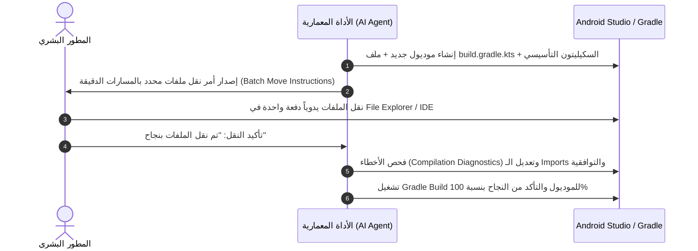
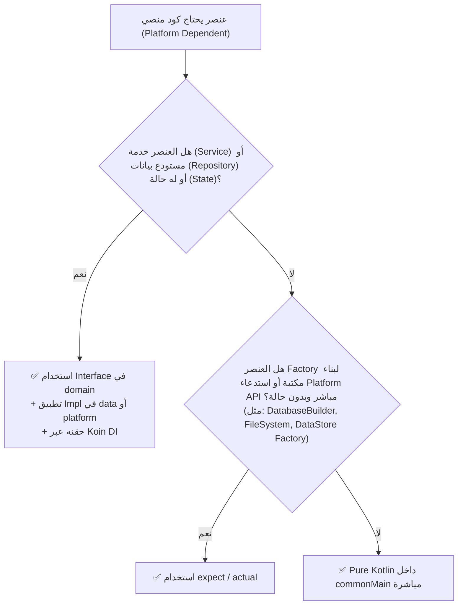

# وثيقة الخطة المعمارية الشاملة والقواعد الصارمة للتحول إلى Compose Multiplatform (CMP)
### مشروع: **زاد المؤمن (Zad El Momen / محراب المؤمن)**
### المشروع المرجعي المعتمد: **UNS-App (`E:\UNS-App`)**
### تاريخ الوثيقة: نوفمبر 2026

---

## 📑 فهرس المحتويات
1. [المبادئ التوجيهية والقواعد الصارمة لأي أداة ذكاء اصطناعي (Strict Agent Guardrails)](#1-المبادئ-التوجيهية-والقواعد-الصارمة)
2. [استراتيجية توفير التوكنز والتعاون بين الأداة والمطور (Token Optimization Protocol)](#2-استراتيجية-توفير-التوكنز)
3. [المفاضلة المعمارية الصارمة: Interface + Impl مقابل Expect / Actual](#3-المفاضلة-المعمارية-الصارمة)
4. [طوبولوجيا وهيكل الموديولات المستهدفة (Target Architecture)](#4-طوبولوجيا-وهيكل-الموديولات)
5. [خريطة ترحيل المكونات والتبعيات (Migration Map)](#5-خريطة-ترحيل-المكونات-والتبعيات)
6. [التعامل مع الحالات المنصية الخاصة والمعقدة (Special & Platform Subsystems)](#6-التعامل-مع-الحالات-المنصية-الخاصة)
7. [خارطة الطريق التنفيذية خطوة بخطوة (Step-by-Step Execution Plan)](#7-خارطة-الطريق-التنفيذية-خطوة-بخطوة)
8. [بروتوكول التحقق والـ Rollback (Verification & Safety Gates)](#8-بروتوكول-التحقق-والـ-rollback)

---

## 1. المبادئ التوجيهية والقواعد الصارمة لأي أداة ذكاء اصطناعي (Strict Agent Guardrails)

> [!CAUTION]
> **قواعد غير قابلة للتفاوض (Non-Negotiable Rules):**
> أي أداة ذكاء اصطناعي (AI Agent) تعمل على هذا المشروع يجب أن تلتزم بالقواعد التالية دون أي استثناء لمنع الهلوسة وفقدان الأكواد أو إفساد بيئة العمل:

1. **الحظر المطلق لحذف الأكواد الأصلية قبل التحقق التام (Never Delete Before 100% Verification):**
   - يُمنع منعاً باتاً حذف أو تفريغ أو استبدال أي كلاس أو ملف من موديول `:app` القديم أثناء العمل.
   - يظل الموديول القديم كاملاً وقابلاً للبناء كـ Fallback وكمرجع مطابقة حتى انتهاء المرحلة السابعة بالكامل واختبار التطبيق بنجاح.
2. **الحفاظ الصارم على الواجهة وتجربة المستخدم (Pixel-Perfect & Behavior Consistency):**
   - يُمنع إدخال أي تعديلات تحسينية أو تغيير في الـ Design، الـ Margins، الـ Paddings، الألوان، أو تدفق التنقل (`Navigation Flow`).
   - التحويل يكون مقتصراً على استبدال استيرادات Jetpack Compose بالأصلية لـ Compose Multiplatform (`org.jetbrains.compose.*`).
3. **الاعتماد الحصري على مراجع `UNS-App` للمكتبات:**
   - ملف `E:\UNS-App\gradle\libs.versions.toml` وملفات الـ `build.gradle.kts` فيه هي المرجع الحصري الوحيد لإصدارات KMP و Compose Multiplatform ومكتبات Koin و Room KMP و Ktor.
   - لا يجوز تخمين إصدارات جديدة أو تجربة مكتبات غير معتمدة في المشروع المرجعي.
4. **التنفيذ التراكمي مرحلة بمرحلة (Incremental Progression):**
   - يُمنع فتح أكثر من موديول في نفس الوقت.
   - ينتهي الموديول بالكامل -> يتم عمل Gradle Sync -> يتم عمل Build للموديول بنجاح 100% -> الانتقال للموديول التالي.

---

## 2. استراتيجية توفير التوكنز والتعاون بين الأداة والمطور (Token Optimization Protocol)

لمنع استهلاك الـ Context Window ونفاد التوكنز في طباعة آلاف أسطر الكود الموجودة بالفعل، نعتمد هذا التقسيم الصارم للعمل:



### القواعد الإجرائية للأداة:
- **لا تقم بإعادة كتابة الكلاسات الكبيرة (مثل `HighlightingViewModel`, `PrayerTimesWidgetProvider`, `MehrabColors`) في الشات.**
- وجّه المطور دائماً إلى مسار النقل:
  `انقل المجلد من [app/src/main/java/.../domain/model] إلى [domain/src/commonMain/kotlin/.../domain/model]`
- وظيفة الأداة هي:
  1. كتابة ملفات التكوين والتهيئة السليمة (`build.gradle.kts`, `settings.gradle.kts`, `libs.versions.toml`).
  2. إنشاء الـ Interfaces والمصانع الأساسية (`DatabaseBuilder`, `PlatformContext`).
  3. فحص الأخطاء وعلاج مشاكل الـ Types وحل مشاكل الـ Imports بعد النقل.

---

## 3. المفاضلة المعمارية الصارمة: Interface + Impl مقابل Expect / Actual

قاعدة ذهبية: **لا تستخدم `expect / actual` إلا عندما تفشل كل الطرق الأخرى عبر واجهات الـ OOP وحقن التبعيات.**



### جدول التصنيف الصارم لكافة مكونات زاد المؤمن:

| المكون / النظام الفرعي | التصنيف المعتمد | مكان التعريف | مكان التطبيق (Android / iOS) | المبرر المعماري |
| :--- | :--- | :--- | :--- | :--- |
| **مشغل الصوتيات (AudioPlayer)** | `Interface + Impl` | `domain/.../AudioPlayer.kt` | • Android: `AndroidAudioPlayer` (Media3/ExoPlayer)<br>• iOS: `IosAudioPlayer` (AVPlayer) | منطق خدمة متغيرة الحالة (`Stateful Service`) يتطلب Mocking واختبارات. |
| **محدد المواقع (LocationRepository)** | `Interface + Impl` | `domain/.../LocationRepository.kt` | • Android: `FusedLocationProviderClient`<br>• iOS: `CLLocationManager` | Repository يطلق تدفقات بيانات (`Flows`). |
| **حساس البوصلة والقبلة (CompassSensorManager)** | `Interface + Impl` | `domain/.../QiblahRepository.kt` | • Android: `SensorManager` (Accel + Magnetic)<br>• iOS: `CoreMotion` | عتاد منصي يتم التعامل معه كـ DataSource. |
| **محرك الذكاء الاصطناعي للتسميع (SherpaEngine)** | `Interface + Impl` | `domain/.../RecitationEngine.kt` | • Android: `SherpaOnnxEngine` (AAR/JNI)<br>• iOS: `IosRecitationEngineStub` | المحرك عبارة عن AAR أندرويد حالياً، والواجهة تسمح بتشغيله على أندرويد دون كسر كود الـ UI المشترك. |
| **التقويم الهجري (HijriCalendarProvider)** | `Interface + Impl` | `domain/.../HijriCalendarProvider.kt` | • Android: `UmmalquraCalendar` (أو Pure Kotlin)<br>• iOS: `Pure Kotlin Hijri Calculator` | تجريد مكتبة Java لضمان عمل نفس واجهات التواريخ. |
| **المنبهات والإشعارات (AlarmScheduler / NotificationScheduler)** | `Interface + Impl` | `domain/.../AlarmScheduler.kt` | • Android: `AlarmManager` + `NotificationManager`<br>• iOS: `UNUserNotificationCenter` | خدمات نظام تشغيل معقدة تتطلب أذونات مختلفة. |
| **إدارة المشتريات والتبرعات (BillingService)** | `Interface + Impl` | `domain/.../BillingService.kt` | • Android: `BillingManager` (Google Play Billing)<br>• iOS: `StoreKit` | واجهة مالية منفصلة لكل متجر. |
| **بناء قاعدة البيانات (Room DatabaseBuilder)** | `expect / actual` | `data/.../DatabaseBuilder.kt` | • Android: `Room.databaseBuilder(context, ...)`<br>• iOS: `Room.databaseBuilder(bundlePath, ...)` | مصنع استدعاء محلي بدون منطق عمل. |
| **بناء مخزن الإعدادات (DataStore Factory)** | `expect / actual` | `data/.../DataStoreFactory.kt` | • Android: مسار تخزين الملف في Context<br>• iOS: مسار التخزين في DocumentDirectory | كود منصي بحت لتحديد مسار الملف. |

---

## 4. طوبولوجيا وهيكل الموديولات المستهدفة (Target Architecture)

المشروع يتم إعادة هيكلته إلى 6 موديولات رئيسية:

```
E:\Zad-El-Momen\
├── settings.gradle.kts                # إدارة وتضمين الموديولات
├── build.gradle.kts                   # Plugins المشتركة
├── gradle/libs.versions.toml          # كتالوج الإصدارات المشترك الموحد
│
├── :domain/                           # [Pure Kotlin Multiplatform]
│   └── src/commonMain/kotlin/         # لا يعتمد على أندرويد إطلاقاً
│       └── dev/sayed/mehrabalmomen/domain/
│           ├── model/                 # Data classes & Enums
│           ├── entity/                # KMP Entities
│           ├── repository/            # Interfaces
│           ├── usecase/               # UseCases
│           └── analytics/             # Contracts
│
├── :designSystem/                     # [Compose Multiplatform]
│   └── src/commonMain/
│       ├── composeResources/          # الخطوط المشتركة
│       └── kotlin/dev/sayed/mehrabalmomen/designsystem/
│           ├── color/                 # MehrabColors, Themes
│           ├── text_style/            # Typography
│           ├── theme/                 # Theme & Providers
│           └── component/             # Buttons, AppBars, Switches, TextFields
│
├── :data/                             # [Kotlin Multiplatform Library]
│   ├── src/commonMain/kotlin/         # Room KMP, Ktor, Supabase, Repositories
│   ├── src/androidMain/kotlin/        # ExoPlayer, Sherpa, Sensors, Android DB Builder
│   └── src/iosMain/kotlin/            # Darwin Ktor, AVPlayer, iOS DB Builder
│
├── :presentation/                     # [Compose Multiplatform]
│   └── src/commonMain/
│       ├── composeResources/          # الصور، الأيقونات، سلاسل النصوص (Strings)
│       └── kotlin/dev/sayed/mehrabalmomen/presentation/
│           ├── navigation/            # CMP Navigation & Routes
│           ├── screen/                # All Screens & ViewModels
│           ├── components/            # Shared UI Containers
│           └── base/                  # BaseViewModel, UiText, UiIcon
│
├── :shared/                           # [KMP DI & Glue]
│   └── src/commonMain/kotlin/         # Koin Application Initializer & Root Composable
│       └── dev/sayed/mehrabalmomen/shared/
│           ├── di/                    # Combined Koin Modules
│           └── MehrabApp.kt           # The Entry Composable for all platforms
│
├── :androidApp/                       # [Android Application Target]
│   └── src/main/
│       ├── AndroidManifest.xml        # الصلاحيات والـ Receivers والـ Services
│       ├── res/                       # أيقونات التطبيق و الـ AppWidget XMLs
│       └── kotlin/dev/sayed/mehrabalmomen/
│           ├── MainActivity.kt        # Hosts MehrabApp()
│           ├── MehrabApplication.kt   # Koin initialization
│           ├── reciver/               # Boot, Azan, Daily, Reminder Receivers
│           ├── service/               # PrayerAlarmService, FCM Service
│           └── widget/                # PrayerTimesWidgetProvider (RemoteViews)
│
└── :app/                              # [LEGACY - يبقى معطلاً للقراءة فقط حتى نهاية المشروع]
```

---

## 5. خريطة ترحيل المكونات والتبعيات (Migration Map)

### أ. تحديث مكتبات `gradle/libs.versions.toml`
يتم استبدال/ترقية المكتبات بالنسخ المعتمدة في `UNS-App`:
- استبدال `androidx.compose.*` بـ `composeMultiplatform` ("1.11.1").
- استبدال `androidx.navigation:navigation-compose` بـ `org.jetbrains.androidx.navigation:navigation-compose`.
- استبدال `androidx.lifecycle:lifecycle-viewmodel-compose` بـ `org.jetbrains.androidx.lifecycle:lifecycle-viewmodel-compose`.
- استبدال `io.coil-kt:coil-compose:2.7.0` بـ `io.coil-kt.coil3:coil-compose:3.0.4` مع `coil-network-ktor3`.
- ترقية `Room` إلى `2.8.4` مع إضافة `androidx-sqlite-bundled`.
- ترقية `Koin` إلى `4.1.1` مع `koin-compose` و `koin-compose-viewmodel`.
- الحفاظ على `batoulapps.adhan:adhan2:0.0.6` (تدعم KMP).
- الحفاظ على مكتبات الأندرويد في `androidMain` فقط: `billing-ktx`, `media3-exoplayer`, `work-runtime-ktx`, `play-services-location`.

---

## 6. التعامل مع الحالات المنصية الخاصة والمعقدة (Special Subsystems)

### 1. محرك التسميع (`Sherpa-ONNX`)
- **الواقع:** يعتمد على `app/libs/sherpa-onnx-2.0.1.aar`، وهو ملف ثنائي يضم مكتبات C++ لأنوية `armeabi-v7a` و `arm64-v8a`.
- **الحل:** 
  - في `:domain`: ننشئ عقد `RecitationEngine` يحوي دوال التدفق `transcribe(...)`, `resetBuffer()`, `destroy()`.
  - في `:data/src/androidMain`: يظل ملف `SherpaEngine.kt` و `AudioPipeline.kt` مرتبطاً بالـ `.aar` ومحمي بـ `try/catch` مع تطبيق الـ Contract.
  - في `:data/src/iosMain`: تطبيق رمزي `IosRecitationEngine` يعيد حالة "غير مدعوم حالياً على هذا النظام" دون التأثير على عمل الأندرويد أو تكسير بناء التطبيق.
  - شاشة `HighlightingViewModel` تُحقن بـ `RecitationEngine` من الـ `domain`، وتعمل على CMP بدون أي تعديل في واجهتها!

### 2. خدمات الأذان، الـ Widget، والـ Receivers
- **الواقع:** هذه المكونات تخص منصة الأندرويد تحديداً (Android Alarms, Foreground Service, RemoteViews).
- **الحل:**
  - تبقى داخل موديول `:androidApp`.
  - يتم استهلاك البيانات عبر حقن الـ Repositories من `:domain` و `:data` باستخدام `KoinJavaComponent` أو استدعاءات `get()` داخل الـ Service والـ Receiver.
  - الـ Widget يبقى كما هو يعمل بنسبة 100% بدون أي تغيير في كوده.

### 3. الخرائط والموقع (`MapLibre Compose` و GPS)
- في أندرويد يتم استمرار استخدام مكتبة MapLibre الخاصة بأندرويد أو KMP Wrapper، ويتم عزل شاشة الخرائط بحيث تعمل عبر Platform View أو KMP Composables المتاحة.

### 4. الموارد وسلاسل النصوص والخطوط (`Resources`)
- تحويل جميع ملفات `strings.xml` والـ `drawable` إلى `presentation/src/commonMain/composeResources/` واستخدام كلاس التوليد التلقائي `Res`.

---

## 7. خارطة الطريق التنفيذية خطوة بخطوة (Step-by-Step Execution Plan)

### 📍 المرحلة 0: مواءمة ملفات التكوين والـ Version Catalog
1. **الأداة:** دمج حزم ومكتبات `UNS-App` في `gradle/libs.versions.toml`.
2. **الأداة:** تحديث `settings.gradle.kts` لإضافة الوحدات الست الجديدة.
3. **الأداة:** تحديث `build.gradle.kts` الرئيسي.
4. **التحقق:** تنفيذ `gradlew --dry-run` أو `gradle_sync` والتأكد من عدم وجود تعارض plugins.

---

### 📍 المرحلة 1: إنشاء ونقل موديول الدومين (`:domain`)
1. **الأداة:** إنشاء `domain/build.gradle.kts` (نقي 100% KMP مطابق لـ `UNS-App/domain`).
2. **المطور:** نقل المجلدات الآتية من `app/.../domain/` إلى `domain/src/commonMain/kotlin/dev/sayed/mehrabalmomen/domain/`:
   - `model/`
   - `entity/`
   - `repository/`
   - `usecase/`
   - `analytics/`, `exceptions/`, `mapper/`
3. **الأداة:** مراجعة الكود، استبدال أي استيرادات أندرويد بـ `kotlinx-datetime` أو بدائل نقية.
4. **التحقق:** تشغيل أمر البناء:
   `gradle :domain:compileKotlinCommonMain` والتأكد من خلوه من أي خطأ.

---

### 📍 المرحلة 2: إنشاء ونقل موديول نظام التصميم (`:designSystem`)
1. **الأداة:** إنشاء `designSystem/build.gradle.kts` وتفعيل `compose.resources`.
2. **المطور:** نقل الخطوط من `app/src/main/res/font/` إلى `designSystem/src/commonMain/composeResources/font/`.
3. **المطور:** نقل ملفات `design_system/` من الموديول القديم إلى `designSystem/src/commonMain/kotlin/dev/sayed/mehrabalmomen/designsystem/`:
   - `color/`, `text_style/`, `theme/`, `component/`
4. **الأداة:** تصحيح استيرادات الـ Compose إلى `org.jetbrains.compose.*` وتعديل تحميل الخطوط لـ `Res.font.*`.
5. **التحقق:** بناء الموديول بنجاح:
   `gradle :designSystem:assemble`

---

### 📍 المرحلة 3: إنشاء ونقل موديول البيانات (`:data`)
1. **الأداة:** إعداد `data/build.gradle.kts` (تضمين Room KMP, KSP, SQLite Bundled, Ktor, Supabase, BuildKonfig).
2. **الأداة:** كتابة الـ `expect / actual` الخاصة ببناء قاعدة البيانات `AppDatabase` و `DataStore`.
3. **المطور:** نقل ملفات البيانات المشتركة إلى `data/src/commonMain/kotlin/...`:
   - `data/azkar/`, `data/quran/`, `data/radio/`, `data/prayer/`, `data/settings/`, `data/bugReport/`, `data/companion/`, `data/reminders/`
   - نقل كيانات قاعدة البيانات والـ DAOs.
4. **المطور:** نقل التطبيقات المنصية إلى `data/src/androidMain/kotlin/...`:
   - `AndroidAudioPlayer.kt`, `CompassSensorManager.kt`, `LocationRepositoryImpl.kt`, `BillingManager.kt`, `SherpaEngine.kt`
5. **التحقق:** توليد ملفات KSP لـ Room وبناء الموديول بنجاح:
   `gradle :data:assemble`

---

### 📍 المرحلة 4: إنشاء ونقل موديول العرض (`:presentation`)
1. **الأداة:** إنشاء `presentation/build.gradle.kts` (نفس إعدادات `UNS-App/presentation`).
2. **المطور:** نقل الموارد (الرسومات والـ Strings والـ JSONs) من `app/src/main/res/` و `assets/` إلى `presentation/src/commonMain/composeResources/`.
3. **المطور:** نقل كود الشاشات والـ ViewModels والتنقل إلى `presentation/src/commonMain/kotlin/...`:
   - `screen/`, `navigation/`, `components/`, `base/`
4. **الأداة:** تحويل استيرادات الـ ViewModel لـ `org.jetbrains.androidx.lifecycle.ViewModel` وتحويل الموارد لـ `Res.*`.
5. **التحقق:** تشغيل الفحص وبناء الموديول بنجاح:
   `gradle :presentation:assemble`

---

### 📍 المرحلة 5: إنشاء موديول الربط المركزي (`:shared`)
1. **الأداة:** إنشاء `shared/build.gradle.kts`.
2. **الأداة:** تجميع موديولات Koin في `KoinAppDeclaration.kt` في `commonMain`.
3. **الأداة:** إنشاء الكومبوننت الرئيسي الموحد:
   ```kotlin
   @Composable
   fun MehrabApp() {
       MehrabTheme {
           MainContainer()
       }
   }
   ```
4. **التحقق:** بناء الموديول بنجاح: `gradle :shared:assemble`

---

### 📍 المرحلة 6: إعداد موديول الأندرويد المستهدف (`:androidApp`)
1. **الأداة:** إنشاء `androidApp/build.gradle.kts` (نسخة من `UNS-App/androidApp/build.gradle.kts`).
2. **المطور:** نقل المكونات المنصية البحتة من `:app` إلى `:androidApp`:
   - `MainActivity.kt` (فقط تستدعي `setContent { MehrabApp() }`).
   - `MehrabApplication.kt` (تهيئة Koin).
   - `reciver/` (كافة الـ BroadcastReceivers).
   - `service/` (الخدمات المنصية).
   - `widget/` (AppWidget).
   - `AndroidManifest.xml` وملفات الـ mipmap/drawables الخاصة بالأيقونات.
3. **التحقق:** تشغيل التطبيق بالكامل على محاكي/جهاز أندرويد واختبار كافة الميزات الحية.

---

### 📍 المرحلة 7: الفحص النهائي والاستغناء عن `:app` القديم
1. اختبار كل الميزات:
   - [ ] قراءة القرآن والتلاوات الصوتية والتظليل (Highlighting).
   - [ ] التسميع بالذكاء الاصطناعي (Tasmee3 عبر Sherpa-ONNX).
   - [ ] الأذكار والسبحة والتخزين المحلي.
   - [ ] حساب مواقيت الصلاة والمنبهات وإشعار الأذان في الخلفية.
   - [ ] اتجاه القبلة والبوصلة.
   - [ ] ويدجت مواقيت الصلاة على الشاشة الرئيسية (Widget).
   - [ ] الراديو والإعدادات والتبرعات.
2. بعد التأكد من عمل التطبيق 100% بدون أي أخطاء أو نواقص:
   - يتم إيقاف وتفريغ الموديول القديم `:app` بأمان وحذفه من `settings.gradle.kts`.

---

## 8. بروتوكول التحقق والـ Rollback (Safety & Verification Gates)

| البوابة (Gate) | شرط الاجتياز (Criteria) | إجراء الطوارئ عند الفشل (Rollback) |
| :--- | :--- | :--- |
| **Gate 1: Domain** | نجاح `compileKotlinCommonMain` بنسبة 100% وخلوه من أي استيراد لـ `android.*`. | الرجوع للـ Git Commit السابق للمرحلة وتصحيح الكيانات المتبقية. |
| **Gate 2: DesignSystem** | نجاح ترجمة مكونات CMP وعرض الخطوط المشتركة بنجاح. | التأكد من مسارات `composeResources/font/` ومطابقة أسماء الخطوط. |
| **Gate 3: Data (Room KMP)** | نجاح توليد كود الـ KSP لـ Room لجميع الـ Targets (`kspCommonMainMetadata`, `kspAndroid`). | مطابقة ملف الـ Schema والتأكد من إعدادات الـ SQLite Driver. |
| **Gate 4: Presentation** | مطابقة الشاشات ونجاح ترجمة الـ ViewModels والتنقل. | مراجعة استيرادات Compose وتعديل أي استدعاء قديم لـ `R.*`. |
| **Gate 5: End-to-End Build** | إطلاق `androidApp` واجتياز كافة السيناريوهات على الجهاز. | الاعتماد على كود `:app` الأصلي المحفوظ كمرجع لإصلاح أي اختلاف. |

---
**اعتماد الوثيقة:**
هذه الوثيقة ملزمة لأي أداة ذكاء اصطناعي أو مطور يبدأ أو يستكمل عملية الترحيل في هذا المشروع.

