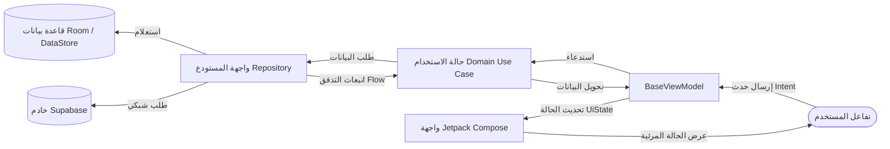

<!--
  =======================================================================
  زاد المؤمن (Zad Al-Mu'min) - تطبيق إسلامي مفتوح المصدر لمنصة أندرويد
  =======================================================================
-->

<div align="center" dir="rtl">

  <a href="https://github.com/ElsayedMagdy122/Zad-El-Momen">
    
  </a>

  <h1 align="center">زاد المؤمن | Zad Al-Mu'min</h1>

  <p align="center">
    <strong>تطبيق إسلامي حديث ومتكامل، مفتوح المصدر، يعمل دون إنترنت (Offline-First)، مزود بمحرك ذكاء اصطناعي محلي لمراجعة وتسميع القرآن الكريم، مع مواقيت صلاة دقيقة وواجهة عصرية مبنية بأحدث تقنيات Jetpack Compose.</strong>
  </p>

  <p align="center">
    <a href="README.md"><strong>English Version</strong></a> •
    <a href="#-أهم-المميزات">أهم المميزات</a> •
    <a href="#-المعمارية-وهيكل-المشروع">المعمارية وهيكل المشروع</a> •
    <a href="#-حزمة-التقنيات-المستخدمة">التقنيات المستخدمة</a> •
    <a href="#-دليل-التثبيت-والتشغيل-المحلي">التثبيت والتشغيل</a> •
    <a href="#-المساهمة-في-المشروع">المساهمة</a>
  </p>

  <p align="center">
    <!-- الشارات التقنية -->
    <a href="https://developer.android.com">
      
    </a>
    <a href="https://kotlinlang.org">
      
    </a>
    <a href="https://developer.android.com/jetpack/compose">
      
    </a>
  </p>

  <p align="center">
    <!-- المعمارية، الترخيص، فحص الجودة -->
    <a href="#-المعمارية-وهيكل-المشروع">
      
    </a>
    <a href="https://insert-koin.io/">
      
    </a>
    <a href="https://github.com/ElsayedMagdy122/Zad-El-Momen/actions">
      
    </a>
    <a href="https://github.com/ElsayedMagdy122/Zad-El-Momen/pulls">
      
    </a>
    <a href="LICENSE">
      
    </a>
  </p>

  <p align="center">
    <a href="https://play.google.com/store/apps/details?id=dev.sayed.mehrabalmomen">
      
    </a>
  </p>

</div>

---

## 📌 نظرة عامة على المشروع

**زاد المؤمن (Zad Al-Mu'min)** هو تطبيق إسلامي متكامل ومفتوح المصدر لمنصة أندرويد، صُمم ليكون الرفيق اليومي الأمثل لكل مسلم. تم بناء التطبيق من الصفر وفق أحدث معايير تطوير تطبيقات أندرويد الرسمية (**Modern Android Development - MAD**)، جامعاً بين التصميم الجمالي المريح للعين والهندسة البرمجية الصارمة.

### لماذا زاد المؤمن؟
تعاني العديد من التطبيقات الإسلامية الحالية من كثرة الإعلانات المنبثقة المزعجة، أو استهلاك بطارية الهاتف، أو اشتراط الاتصال الدائم بالإنترنت. **تأسس مشروع زاد المؤمن على ثلاثة مرتكزات رئيسية**:
1. **الخصوصية التامة والعمل دون إنترنت (Offline-First):** تُعالج كافة العمليات الحساسة—مثل التسجيل الصوتي لمراجعة الحفظ، أو حساب اتجاه القبلة عبر الحساسات—محلياً على جهاز المستخدم دون نقل أي بيانات صوتية أو شخصية إلى خوادم خارجية.
2. **الذكاء الاصطناعي على الجهاز (On-Device AI):** دمج نماذج التعرف الآلي على الكلام (ASR) عبر تقنية **Sherpa-ONNX** لتمكين المستخدم من تسميع القرآن ومراجعة حفظه ذاتياً وبدقة عالية دون الحاجة للاتصال بالإنترنت.
3. **نقاء المعمارية البرمجية:** فصل تام وواضح بين طبقات العرض والمنطق والبيانات وفق مبادئ **Clean Architecture**، مع استخدام **Jetpack Compose** للواجهات، و**Kotlin Coroutines & Flow** للعمليات اللاتزامنية، و**Koin** لحقن الاعتماديات، و**Room** لإدارة البيانات المحلية.

---

## 📸 لقطات شاشة من التطبيق

<div align="center">
  <table>
    <tr>
      <th align="center">🏠 الشاشة الرئيسية ومواقيت الصلاة</th>
      <th align="center">📖 المصحف ووضع القراءة</th>
      <th align="center">🕋 مواقيت الصلاة التفصيلية</th>
      <th align="center">📋 فهرس سور القرآن</th>
      <th align="center">📿 الأذكار وحصن المسلم</th>
    </tr>
    <tr>
      <td align="center">
        
      </td>
      <td align="center">
        
      </td>
      <td align="center">
        
      </td>
      <td align="center">
        
      </td>
      <td align="center">
        
      </td>
    </tr>
    <tr>
      <th align="center">📻 إذاعة القرآن الكريم مباشر</th>
      <th align="center">📚 التفسير ومعاني الآيات</th>
      <th align="center">🧭 بوصلة القبلة الدقيقة</th>
      <th align="center">⚙️ إعدادات الحساب والمظهر</th>
      <th align="center">🤖 مراجعة الحفظ بالذكاء الاصطناعي</th>
    </tr>
    <tr>
      <td align="center">
        
      </td>
      <td align="center">
        
      </td>
      <td align="center">
        
      </td>
      <td align="center">
        
      </td>
      <td align="center">
        
      </td>
    </tr>
  </table>
</div>

---

## ✨ أهم المميزات

### 🎙️ مراجعة الحفظ والتسميع الذكي بالذكاء الاصطناعي (On-Device AI)
- **معالجة عصبية محلية بالكامل:** الاعتماد على مكتبة **Sherpa-ONNX** لتشغيل نماذج تحويل الصوت لنص لحظياً داخل الهاتف دون استهلاك باقة الإنترنت أو إرسال الصوت لسيرفرات خارجية.
- **مطابقة الكلمات وتمييز الآيات:** تحليل فوري لمخارج الحروف والكلمات المرتلة، مع تلوين الكلمات وتنبيه القارئ في حال النسيان أو السهو.
- **أقصى درجات الخصوصية:** تعمل ميزة التسميع بكفاءة تامة حتى في وضع الطيران (Airplane Mode).

### 📖 القرآن الكريم والتفسير
- **النص القرآني بالرسم العثماني:** قاعدة بيانات محلية دقيقة تشمل جميع سور القرآن الكريم (114 سورة) مع علامات الوقف والضبط.
- **التفسير الميسر ومعاني الكلمات:** تصفح تفسير الآيات بلمسة واحدة لفهم المعاني والسياق القرآني.
- **العلامات المرجعية (Bookmarks):** حفظ الآيات والسور المفضلة للعودة إليها بسهولة ومتابعة الورد اليومي.
- **البحث الذكي في القرآن:** محرك بحث نصي متقدم يتيح البحث السريع بالكلمات أو أجزاء الآيات وأسماء السور.

### 🕌 مواقيت الصلاة والتنبيه التلقائي بالأذان
- **دقة فلكية عالية:** حساب مواقيت الصلاة بدقة فائقة بالاعتماد على إحداثيات الموقع وخطوط الطول والعرض.
- **تخصيص طرق الحساب والمذاهب:** دعم تقويم أم القرى (مكة المكرمة)، الهيئة المصرية العامة للمساحة، الاتحاد الإسلامي لأمريكا الشمالية (ISNA)، رابطة العالم الإسلامي، مع دعم حساب صلاة العصر وفق المذهبين الحنفي والشافعي.
- **محرك تنبيهات دقيق (AlarmManager):** استخدام منبهات النظام الدقيقة `SCHEDULE_EXACT_ALARM` لضمان رفع الأذان والتنبيه في الثانية المحددة حتى أثناء وضع توفير الطاقة (Doze Mode).
- **شاشة أذان متكاملة فوق شاشة القفل:** واجهة أذان كاملة تظهر تلقائياً وقت دخول الصلاة مع إمكانية كتم الصوت أو الإيقاف السريع.

### 🧭 بوصلة اتجاه القبلة
- **دمج حساسات الجهاز (Sensor Fusion):** استغلال حساسات التسارع والمجال المغناطيسي لتحديد اتجاه الكعبة المشرفة بالنسبة للشمال الجغرافي الحقيقي.
- **معايرة تفاعلية:** إرشادات بصرية تساعد المستخدم على معايرة حساسات الهاتف (حركة 8) لتفادي التداخل المغناطيسي وضمان أقصى دقة.

### 📿 الأذكار وحصن المسلم
- **موسوعة الأذكار اليومية:** أذكار الصباح والمساء، أذكار بعد الصلاة، أذكار النوم والاستيقاظ، والأدعية النبوية المأثورة.
- **سبحة إلكترونية تفاعلية:** عداد ذكي للأذكار مزود باهتزاز لمسي (Haptic Feedback) ومؤشرات مرئية لعدد التكرارات المتبقية.

### 📻 إذاعة القرآن الكريم المباشرة
- **تشغيل في الخلفية عبر Media3 ExoPlayer:** بث إذاعي صوتي عالي النقاء مستقر ومنخفض استهلاك البيانات، يدعم التحكم الكامل من شاشة القفل والإشعارات (`MediaSessionService`).
- **باقة من الإذاعات والقراء:** إذاعات متنوعة تشمل إذاعة القرآن الكريم من القاهرة، مكة، وباقات تلاوة لأشهر القراء في العالم الإسلامي.

### 📱 ودجت شاشة الهاتف (App Widget)
- **مواقيت الصلاة على الشاشة الرئيسية:** ويدجت أنيق وخفيف يعرض مواعيد صلوات اليوم مع عد تنازلي للصلاة القادمة دون الحاجة لفتح التطبيق.

---

## 🛠️ حزمة التقنيات المستخدمة (Tech Stack)

| المجال | التقنية / المكتبة | الغرض البرمجي |
| :--- | :--- | :--- |
| **لغة البرمجة** | [Kotlin 2.0.21](https://kotlinlang.org/) | اللغة الأساسية الحديثة، مع أمان تام ضد القيم الفارغة ومؤشرات تدفق متقدمة |
| **واجهة المستخدم** | [Jetpack Compose BOM](https://developer.android.com/jetpack/compose) | بناء الواجهات بأسلوب التصريح التفاعلي (Declarative UI) |
| **نظام التصميم** | Design System مخصص | مكونات واجهة، طباعة مخصصة، سمات الألوان الفاتحة والداكنة |
| **المعمارية البرمجية** | Clean Architecture + MVVM/MVI | عزل منطق العمل (Domain) عن واجهة العرض ومصادر البيانات |
| **حقن الاعتماديات** | [Koin 4.x](https://insert-koin.io/) | حقن تبعيات عملي وخفيف مبني بلغة كوتلن بالكامل |
| **قاعدة البيانات المحلية** | [Room Database 2.8.4](https://developer.android.com/training/data-storage/room) | طبقة تجريد متطورة فوق SQLite مدعومة بمولد الأكواد KSP |
| **حفظ الإعدادات** | Jetpack DataStore | تخزين آمن ولاتزامني لإعدادات المستخدم وتفضيلاته |
| **البرمجة اللاتزامنية** | Kotlin Coroutines & Flow | إدارة التدفقات والعمليات غير المتزامنة بكفاءة وخفة |
| **الذكاء الاصطناعي والصوت** | [Sherpa-ONNX 2.0.1](https://github.com/k2-fsa/sherpa-onnx) | محرك مدمج لتشغيل نماذج تحويل الصوت لنص على الهاتف |
| **الصوتيات والوسائط** | [AndroidX Media3 ExoPlayer](https://developer.android.com/media/media3) | محرك تشغيل الصوتيات والبث الإذاعي في الخلفية |
| **الخادم السحابي** | [Supabase Kotlin SDK](https://supabase.com/) | المزامنة السحابية وقاعدة البيانات البعيدة وبلاغات الأخطاء |
| **إدارة السحاب والتحليلات** | [Firebase (FCM, Crashlytics, Perf)](https://firebase.google.com/) | تشخيص الأعطال لحظياً ومراقبة الأداء وإرسال الإشعارات |
| **تحميل الصور** | [Coil](https://coil-kt.github.io/coil/) | مكتبة متوافقة بالكامل مع كود Compose لتحميل الصور بكفاءة |
| **التقويم الهجري** | [Umm al-Qura Calendar](https://github.com/msarhan/ummalqura-calendar) | حسابات وتوافقات تقويم أم القرى بدقة تاريخية وفلكية |
| **المهام في الخلفية** | [WorkManager KTX](https://developer.android.com/topic/libraries/architecture/workmanager) | إدارة المهام المؤجلة والمجدولة في الخلفية لضمان الاستمرارية |

---

## 🏛️ المعمارية وهيكل المشروع

يتبع تطبيق **زاد المؤمن** بدقة مبادئ **المعمارية النظيفة (Clean Architecture)**، مما يفصل منطق التطبيق تماماً عن واجهات أندرويد البرمجية، ويجعل الكود قابلاً للاختبار وإعادة الاستخدام والتوسعة.

```text
E:/Zad-El-Momen1/
├── app/
│   ├── src/main/
│   │   ├── AndroidManifest.xml          # الصلاحيات والأنشطة والخدمات والمستقبلات
│   │   ├── res/                         # الموارد: النصوص (عربي/إنجليزي)، الصور، الخطوط
│   │   └── java/dev/sayed/mehrabalmomen/
│   │       ├── data/                    # طبقة البيانات (مصادر البيانات المحلية والبعيدة والمستودعات)
│   │       │   ├── di/                  # وحدات Koin الخاصة بالبيانات (المحلي، البعيد، المستودعات)
│   │       │   ├── quran/               # مصادر نص القرآن والبث الصوتي ومحركات التعرف على الصوت
│   │       │   ├── prayer/              # محركات حساب مواقيت الصلاة وتحديد الإحداثيات
│   │       │   ├── azkar/               # جداول قاعدة بيانات الأذكار والمستودعات
│   │       │   ├── qiblah/              # قراءة ومعالجة بيانات الحساسات المغناطيسية للقبلة
│   │       │   ├── radio/               # محطات الراديو والبث المباشر
│   │       │   ├── tasmee3/             # محولات الذكاء الاصطناعي وملفات النماذج المحلية
│   │       │   ├── platform/            # خدمات النظام: جدولة المنبهات والإشعارات
│   │       │   └── util/                # قاعدة بيانات Room ومدير عمليات الدفع
│   │       ├── domain/                  # طبقة المنطق (أكواد كوتلن نقية تماماً - لا تعتمد على أندرويد)
│   │       │   ├── di/                  # وحدة Koin الخاصة بالـ Domain
│   │       │   ├── entity/              # الكيانات النقية (الآية، السورة، وقت الصلاة، الذكر، المحطة)
│   │       │   ├── repository/          # واجهات المستودعات (Interfaces / Contracts)
│   │       │   ├── usecase/             # حالات الاستخدام المستقلة (Use Cases)
│   │       │   ├── tasmee3/             # نماذج التحقق من صحة القراءة ومطابقة الكلمات
│   │       │   └── asr/                 # واجهات التعرف على الصوت المجردة
│   │       ├── presentation/            # طبقة العرض (واجهات Jetpack Compose ونماذج العرض)
│   │       │   ├── di/                  # وحدة Koin لطبقة العرض (ViewModels)
│   │       │   ├── base/                # الـ BaseViewModel والنشاط الرئيسي MainActivity
│   │       │   ├── navigation/          # مسارات وشجرة التنقل داخل Compose
│   │       │   ├── screen/              # شاشات التطبيق (القرآن، الصلاة، الأذكار، القبلة، التسميع...)
│   │       │   ├── widget/              # كود ويدجت الشاشة الرئيسية (PrayerTimesWidgetProvider)
│   │       │   ├── service/             # خدمات الخلفية: خدمة الأذان، إشعارات Firebase
│   │       │   ├── reciver/             # مستقبلات النظام: إعادة التشغيل Boot وتنبيهات الأذان
│   │       │   └── components/          # مكونات الواجهة المشتركة ومربعات الحوار
│   │       └── design_system/           # نظام التصميم (Design System)
│   │           ├── theme/               # السمة العامة، الألوان الداكنة والفاتحة
│   │           ├── color/               # لوحات الألوان الدلالية للتطبيق
│   │           ├── text_style/          # إعدادات الخطوط العربية (الخط العثماني وخطوط الواجهة)
│   │           └── component/           # الأزرار، حقول الإدخال، القوائم المنبثقة المخصصة
│   └── build.gradle.kts                 # مكتبات التطبيق وإعدادات البناء
├── gradle/                              # ملفات Gradle Wrapper وكتالوج الإصدارات (libs.versions.toml)
├── .github/                             # مسارات فحص الجودة والبناء الآلي في GitHub Actions
└── README.md                            # التوثيق الإنجليزي للمشروع
```

### مخطط تدفق البيانات أحادي الاتجاه (Unidirectional Data Flow)


---

## 🚀 دليل التثبيت والتشغيل المحلي

### المتطلبات الأساسية
قبل بناء وتشغيل المشروع على جهازك، تأكد من توفر الآتي:
- **بيئة التطوير (IDE):** Android Studio Ladybug (2024.2.1+) أو إصدار أحدث.
- **حزمة تطوير جافا (JDK):** إصدار JDK 17 (مثل Eclipse Temurin أو المدمج مع أندرويد ستوديو).
- **إصدارات Android SDK:**
  - `compileSdk`: **36**
  - `minSdk`: **26** (أندرويد 8.0 أوريو فما فوق)
  - `targetSdk`: **36**
- **أدوات C++ / NDK:** متطلب لمعمارية `armeabi-v7a` و `arm64-v8a` لتشغيل محرك Sherpa-ONNX.

### خطوات التثبيت خطوة بخطوة

#### 1. استنساخ المستودع (Clone)
```bash
git clone https://github.com/ElsayedMagdy122/Zad-El-Momen.git
cd Zad-El-Momen
```

#### 2. إعداد ملف المتغيرات `local.properties`
أنشئ ملفاً باسم `local.properties` في المجلد الرئيسي للمشروع (إن لم يكن موجوداً)، وأضف مسار الـ SDK ومفاتيح الربط الأساسية:

```properties
sdk.dir=/path/to/your/android-sdk

# بيانات خادم Supabase (مطلوبة لمزامنة البيانات وبلاغات الأخطاء)
SUPABASE_URL="https://your-project.supabase.co"
SUPABASE_KEY="your-anon-key"

# معرفات الدعم الاختياري (يمكن استخدام نصوص وهمية للنسخ التجريبية)
SUPPORT_1="support_tier_1"
SUPPORT_5="support_tier_5"
SUPPORT_10="support_tier_10"
SUPPORT_25="support_tier_25"
SUPPORT_100="support_tier_100"
```

#### 3. إضافة ملف إعدادات Firebase
قم بتنزيل ملف `google-services.json` الخاص بمشروعك من لوحة تحكم Firebase وضعه داخل مجلد `app/`:
```bash
cp /path/to/google-services.json app/google-services.json
```
*(ملاحظة: يمكنك استخدام ملف وهمي `google-services.json` لتشغيل واجهات التطبيق محلياً في حال عدم حاجتك لخدمات Firebase أثناء التطوير).*

#### 4. تجميع وبناء المشروع
قم بتشغيل أمر Gradle لبناء نسخة التطوير التجريبية (Debug APK):
```bash
# على أنظمة Linux / macOS
./gradlew assembleDebug --build-cache

# على نظام Windows عبر PowerShell
.\gradlew.bat assembleDebug --build-cache
```

#### 5. التثبيت والتشغيل على جهاز أو محاكي
```bash
adb install -r app/build/outputs/apk/debug/app-debug.apk
```

---

## 🔒 الصلاحيات والشفافية في الخصوصية

نلتزم في **زاد المؤمن** بأعلى معايير الخصوصية والأمان وفق مبدأ تقليل الصلاحيات للحد الأدنى (Principle of Least Privilege). نوضح هنا أسباب طلب الصلاحيات الحساسة:

| الصلاحية | النطاق | المبرر والضمان الأمني |
| :--- | :--- | :--- |
| `RECORD_AUDIO` | الذكاء الاصطناعي المحلي | تُطلب حصرياً أثناء فتح شاشة **التسميع الذكي** لتسجيل صوت التلاوة وإدخاله لموديل Sherpa-ONNX المحلي. **لا يتم تسجيل أي صوت في الخلفية، ولا يُحفظ الصوت في ملفات دائمة، ولا يُرسل نهائياً إلى أي خادم خارجي.** |
| `ACCESS_FINE_LOCATION` | الحسابات الفلكية | تُستخدم لتحديد إحداثيات الموقع الجغرافي (خطوط الطول والعرض) لحساب مواقيت الصلاة بدقة وزاوية اتجاه القبلة نحو مكة المكرمة. تظل الإحداثيات محفوظة في جهازك فقط. |
| `SCHEDULE_EXACT_ALARM` | مواقيت الأذان | مطلوبة على أندرويد 12 فما فوق لضمان إطلاق تنبيه الأذان في الثانية المحددة بالضبط، حتى عندما يكون الهاتف في وضع السكون العميق (Doze Mode). |
| `FOREGROUND_SERVICE_MEDIA_PLAYBACK` | تشغيل الصوتيات | تُمكن التطبيق من استمرار تشغيل تلاوات القرآن الكريم وإذاعة القرآن الكريم في الخلفية دون انقطاع عند إغلاق الشاشة أو التبديل لتطبيقات أخرى. |
| `RECEIVE_BOOT_COMPLETED` | ضمان استمرارية التنبيهات | لإعادة جدولة منبهات الأذان ومواقيت الصلاة تلقائياً عند إعادة تشغيل الهاتف لضمان عدم تفويت أي صلاة. |
| `POST_NOTIFICATIONS` | الإشعارات | لإرسال إشعارات الأذان ودخول أوقات الصلاة والتذكير بأذكار الصباح والمساء. |

---

## 🗺️ خارطة الطريق (Roadmap)

- [x] إتاحة القرآن الكريم كاملاً دون إنترنت مع التفسير والبحث السريع
- [x] محرك مواقيت الصلاة الفلكي مع دعم المذاهب وطرق الحساب
- [x] مشغل إذاعة القرآن الكريم في الخلفية عبر Media3 ExoPlayer
- [x] الإصدار الأول من ميزة التسميع بالذكاء الاصطناعي عبر Sherpa-ONNX
- [x] ويدجت شاشة الهاتف لمواقيت الصلاة
- [ ] **تطبيق مخصص لساعات أندرويد (Wear OS):** واجهات مخصصة وودجت للساعات الذكية باستخدام Wear Compose M3.
- [ ] **مخطط الختمات القرآTimelineية:** ميزة متطورة لتنظيم وتتبع أوراد ختم القرآن الكريم بمعدلات يومية مرنة.
- [ ] **التلوين التفاعلي لأحكام التجويد:** تمييز أحكام التجويد لونياً أثناء القراءة لتيسير التلاوة المتقنة.
- [ ] **دعم لغات إضافية:** إضافة حزم اللغات الفرنسية، الأردية، الإندونيسية، والتركية.

---

## 🤝 المساهمة في المشروع

نرحب بجميع المساهمات والمقترحات من مجتمع المطورين والمستخدمين! سواء كنت ترغب في حل خطأ برمجي، تحسين الترجمات، أو اقتراح ميزة جديدة:
- يُرجى الاطلاع على دليل [**CONTRIBUTING.md**](CONTRIBUTING.md) قبل تقديم طلبات السحب (Pull Requests).
- يُرجى الالتزام بصيغة تسمية الفروع المدعومة في مسار الفحص الآلي: مثل `feature/your-feature` أو `fix/your-fix`.
- نتوقع من جميع المشاركين الالتزام بميثاق السلوك الموضح في [**CODE_OF_CONDUCT.md**](CODE_OF_CONDUCT.md).

---

## 📄 الترخيص وحقوق الملكية

### الترخيص
هذا المشروع مرخص بموجب رخصة **Apache License 2.0** - راجع ملف [LICENSE](LICENSE) لمزيد من التفاصيل.

### شكر وتقدير
- خالص الشكر للمشاريع الإسلامية المفتوحة التي توفر نصوص القرآن الكريم المعتمدة وتفاسير الآيات.
- فريق مشروع [Sherpa-ONNX](https://github.com/k2-fsa/sherpa-onnx) على محركهم الاستثنائي لتشغيل نماذج الصوت محلياً على الهواتف.
- مجتمع كوتلن وأندرويد مفتوح المصدر على الأدوات والمكتبات التي ترتقي بتجربة التطوير.

<div align="center">
  <sub>صُنع التطبيق بإخلاص وإتقان خدمةً لأمة الإسلام. إن نال التطبيق إعجابك، لا تنسَ دعم المستودع بوضع نجمة ⭐ تشجيعية!</sub>
</div>
