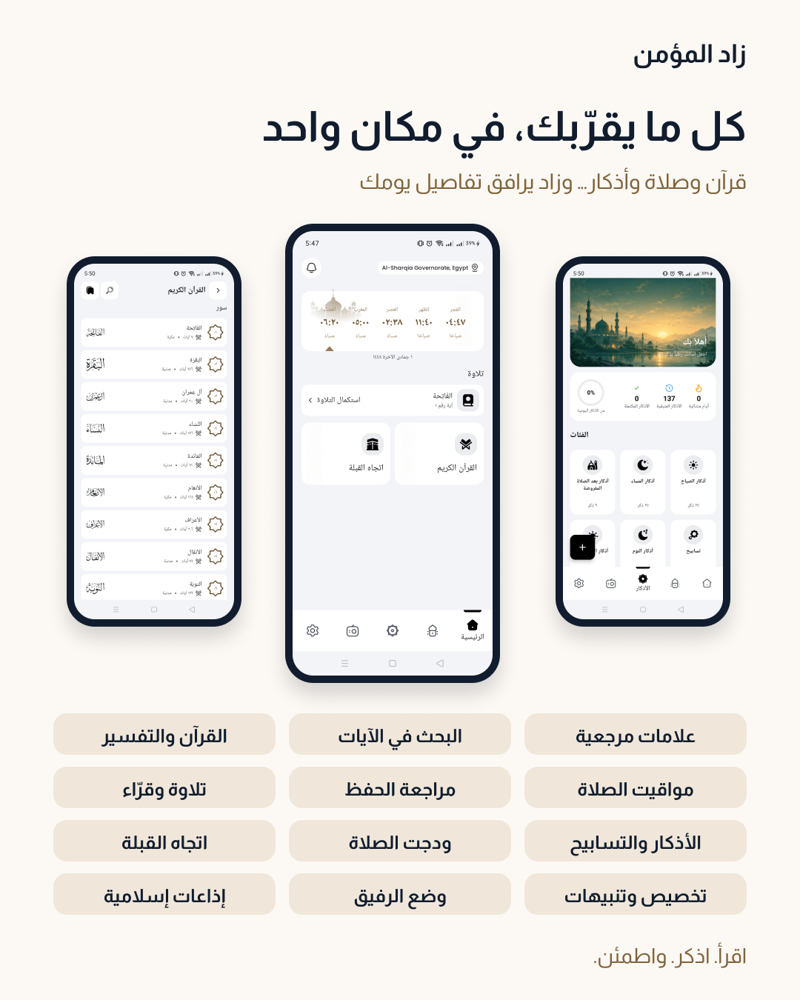
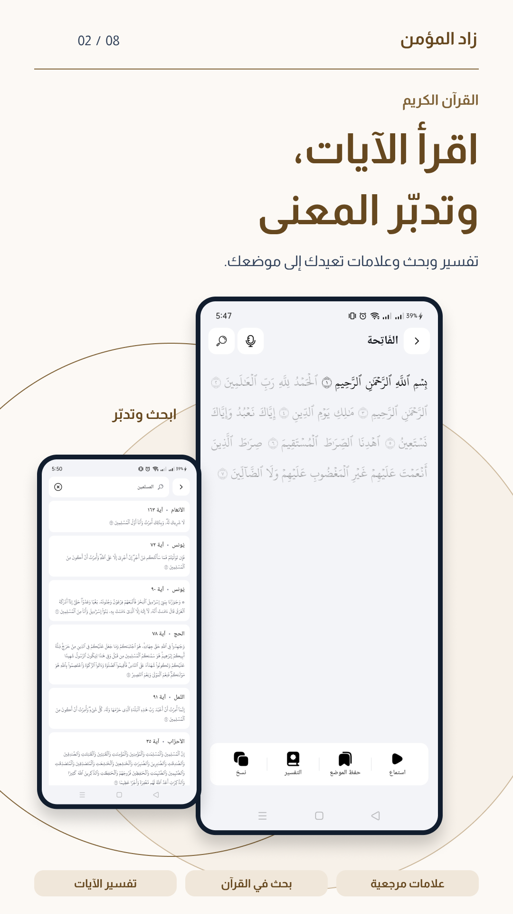
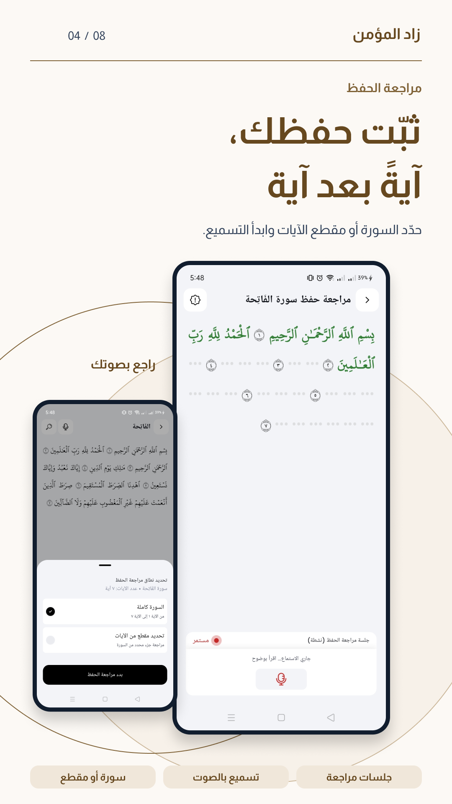
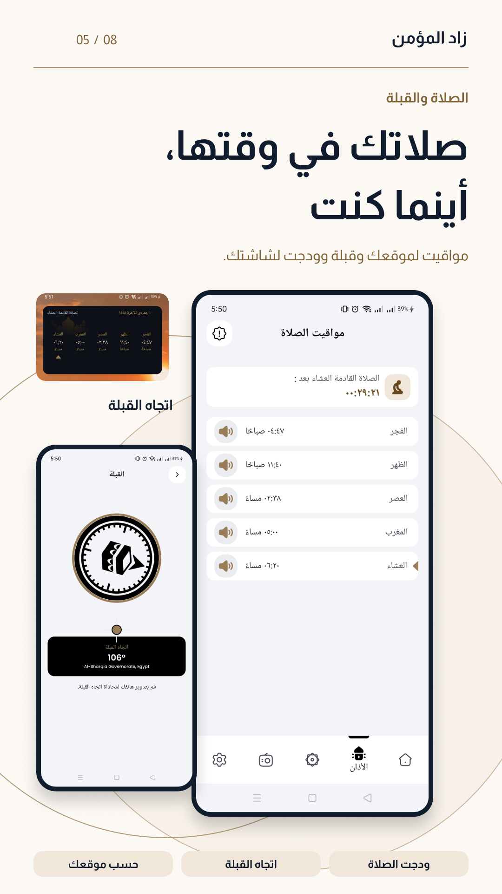
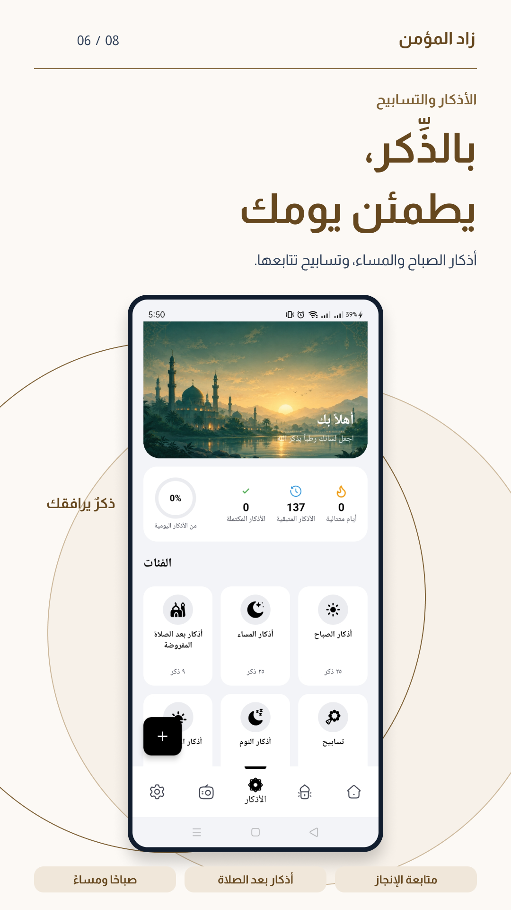
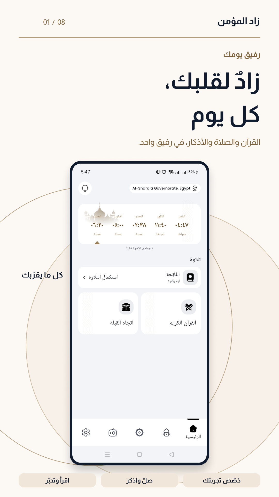
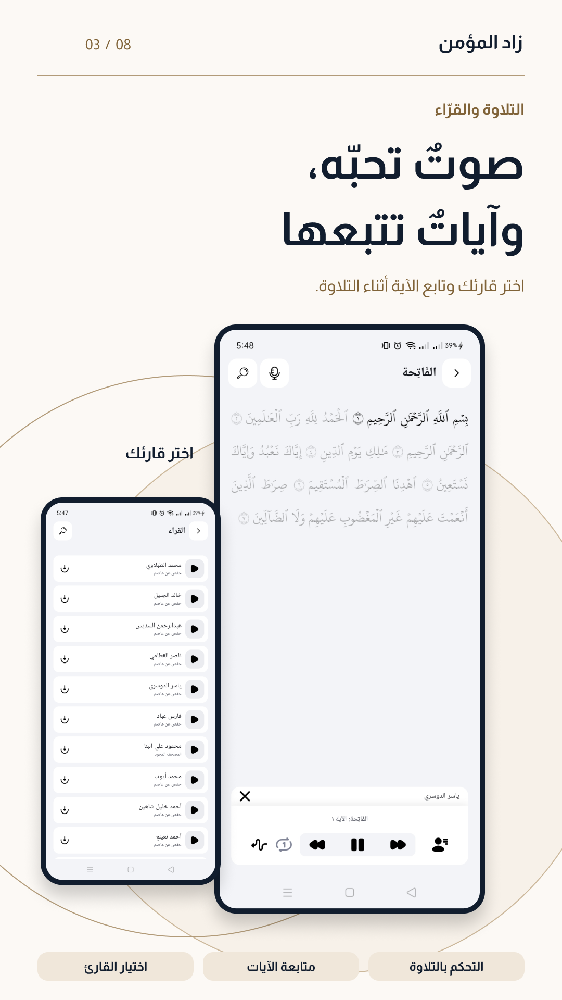
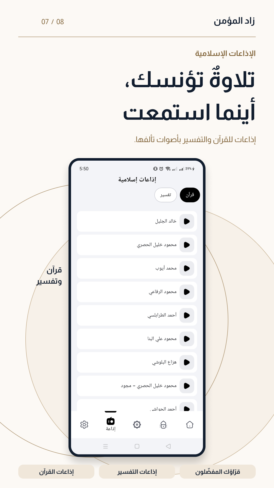
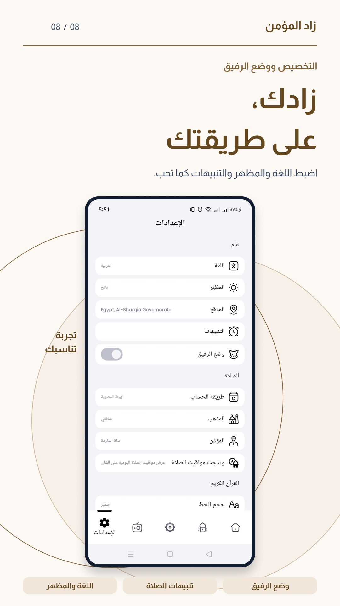

<div align="center" dir="rtl">

  

  <br/><br/>

  <a href="https://github.com/ElsayedMagdy122/Zad-El-Momen">
    
  </a>

  # زاد المؤمن | Zad Al-Mu'min

  **تطبيق إسلامي حديث مفتوح المصدر يعمل دون إنترنت (Offline-First)، مزود بذكاء اصطناعي محلي لمراجعة وتسميع القرآن، مع مواقيت صلاة دقيقة وواجهة عصرية بتقنية Jetpack Compose.**

  [**English**](README.md) • [**المميزات**](#-أهم-المميزات) • [**معرض الشاشات**](#-معرض-الشاشات) • [**التقنيات**](#-حزمة-التقنيات) • [**المعمارية**](#-المعمارية-وهيكل-المشروع) • [**التشغيل السريع**](#-التشغيل-السريع)

  <br/>

  [](https://developer.android.com)
  [](https://kotlinlang.org)
  [](https://developer.android.com/jetpack/compose)
  [](#-المعمارية-وهيكل-المشروع)
  [](https://insert-koin.io/)
  [](https://github.com/ElsayedMagdy122/Zad-El-Momen/actions)
  [](LICENSE)

  <a href="https://play.google.com/store/apps/details?id=dev.sayed.mehrabalmomen">
    
  </a>

</div>

---

## 📸 معرض الشاشات

<div align="center">
  <table>
    <tr>
      <td width="50%"></td>
      <td width="50%"></td>
    </tr>
    <tr>
      <td width="50%"></td>
      <td width="50%"></td>
    </tr>
    <tr>
      <td width="50%"></td>
      <td width="50%"></td>
    </tr>
    <tr>
      <td width="50%"></td>
      <td width="50%"></td>
    </tr>
  </table>
</div>

---

## ✨ أهم المميزات

- 🎙️ **التسميع الذكي (On-Device AI):** مراجعة حفظ القرآن بالذكاء الاصطناعي عبر **Sherpa-ONNX** دون إنترنت وبخصوصية مطلقة (لا يُرسل أي صوت لخوادم خارجية).
- 📖 **المصحف والتفسير:** النص القرآني كاملاً بالرسم العثماني مع التفسير والبحث السريع والعلامات المرجعية.
- 🕌 **مواقيت الصلاة والأذان:** حسابات فلكية دقيقة مع دعم المذاهب وطرق الحساب وتنبيهات منبهات النظام الدقيقة (`AlarmManager`).
- 🧭 **بوصلة القبلة:** دمج حساسات الهاتف مع إرشادات المعايرة لتحديد اتجاه الكعبة بدقة عالية.
- 📿 **الأذكار اليومية:** موسوعة حصن المسلم مع سبحة إلكترونية تفاعلية باهتزاز لمسي.
- 🤝 **رفيق المؤمن:** خواطر وتذكيرات إيمانية وسنن يومية مناسبة لأوقات اليوم.
- 📻 **إذاعة القرآن الكريم 24/7:** بث إذاعي صوتي مستقر ومنخفض الاستهلاك يعمل في الخلفية عبر **Media3 ExoPlayer**.
- 📱 **ويدجت الشاشة الرئيسية:** عرض الصلاة القادمة والوقت المتبقي مباشرة على شاشة الهاتف.

---

## 🛠️ حزمة التقنيات

| المجال | التقنيات المستخدمة |
| :--- | :--- |
| **اللغة والأساسيات** | Kotlin 2.0.21, Coroutines, Flow |
| **واجهة المستخدم** | Jetpack Compose (BOM), Custom Design System, Coil |
| **المعمارية البرمجية** | Clean Architecture (Domain / Data / Presentation), MVI / MVVM |
| **حقن الاعتماديات** | Koin 4.x |
| **قواعد البيانات والحفظ** | Room Database 2.8.4 (KSP), Jetpack DataStore |
| **الذكاء الاصطناعي** | Sherpa-ONNX 2.0.1 (محرك التعرف على الصوت محلياً) |
| **الصوتيات والوسائط** | AndroidX Media3 ExoPlayer |
| **الخدمات السحابية** | Supabase Kotlin SDK, Firebase (FCM, Crashlytics, Perf) |

---

## 🏛️ المعمارية وهيكل المشروع

يعتمد المشروع مبادئ **Clean Architecture** لفصل كامل بين طبقات النظام:

```text
dev.sayed.mehrabalmomen/
├── presentation/   # واجهات Jetpack Compose ونماذج العرض والويدجت
├── domain/         # منطق كوتلن نقي: الكيانات، واجهات المستودعات، حالات الاستخدام
├── data/           # تنفيذ المستودعات، قاعدة بيانات Room، وربط Sherpa-ONNX وخدمات النظام
└── design_system/  # الألوان، الخطوط، ومكونات الواجهة المخصصة
```

📖 *للاطلاع على المخطط التفصيلي للطبقات وتدفق البيانات، راجع [**docs/ARCHITECTURE.md**](docs/ARCHITECTURE.md).*

---

## ⚡ التشغيل السريع

```bash
# 1. استنساخ المستودع
git clone https://github.com/ElsayedMagdy122/Zad-El-Momen.git
cd Zad-El-Momen

# 2. إنشاء ملف local.properties (مفاتيح Supabase ومسار الـ SDK)
# 3. وضع ملف google-services.json داخل مجلد app/

# 4. بناء نسخة التطوير (Debug APK)
./gradlew assembleDebug --build-cache
```

📖 *لدليل الإعداد الكامل وحل المشاكل التقنية، راجع [**docs/SETUP.md**](docs/SETUP.md).*

---

## 🔒 الخصوصية والصلاحيات

تطبيق زاد المؤمن **خالٍ تماماً من الإعلانات ومبني على احترام الخصوصية**:
- `RECORD_AUDIO`: تُستخدم حصرياً لشاشة التسميع الذكي لمعالجة الصوت محلياً داخل المعالج. **لا يتم حفظ الصوت ولا إرساله لأي جهة خارجية.**
- `ACCESS_FINE_LOCATION`: تُستخدم فقط لحساب مواقيت الصلاة الفلكية واتجاه القبلة محلياً دون تتبع الموقع.

📖 *للتفاصيل الكاملة لجميع الصلاحيات، راجع [**docs/PERMISSIONS.md**](docs/PERMISSIONS.md).*

---

## 🤝 المساهمة

نرحب بجميع المساهمات والمقترحات!
- يُرجى قراءة [**CONTRIBUTING.md**](CONTRIBUTING.md) قبل تقديم أي طلب سحب (PR).
- تأكد من تسمية الفرع وفق الصيغ المعتمدة: `feature/xyz` أو `fix/xyz`.
- راجع ميثاق السلوك في [**CODE_OF_CONDUCT.md**](CODE_OF_CONDUCT.md).

---

## 📄 الترخيص

المشروع مرخص بموجب [Apache License 2.0](LICENSE).
