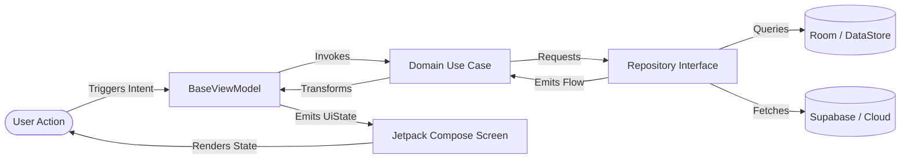

<!--
  =======================================================================
  ZAD AL-MU'MIN (زاد المؤمن) - Open-Source Android Islamic Companion
  =======================================================================
-->

<div align="center">

  

  <a href="https://github.com/ElsayedMagdy122/Zad-El-Momen">
    
  </a>

  <h1 align="center">Zad Al-Mu'min | زاد المؤمن</h1>

  <p align="center">
    <strong>A modern, privacy-focused, offline-first Islamic companion app featuring on-device AI Quran recitation verification, precise prayer times, and smooth Jetpack Compose UI.</strong>
  </p>

  <p align="center">
    <a href="README.ar.md"><strong>العربية</strong></a> •
    <a href="#-key-features">Key Features</a> •
    <a href="#-app-showcase--previews">App Previews</a> •
    <a href="#-architecture--directory-structure">Architecture</a> •
    <a href="#-tech-stack">Tech Stack</a> •
    <a href="#-getting-started--local-setup">Getting Started</a> •
    <a href="#-contributing">Contributing</a>
  </p>

  <p align="center">
    <!-- Platform & Language -->
    <a href="https://developer.android.com">
      
    </a>
    <a href="https://kotlinlang.org">
      
    </a>
    <a href="https://developer.android.com/jetpack/compose">
      
    </a>
  </p>

  <p align="center">
    <!-- Architecture, License, CI, Store -->
    <a href="#-architecture--directory-structure">
      
    </a>
    <a href="https://insert-koin.io/">
      
    </a>
    <a href="https://github.com/ElsayedMagdy122/Zad-El-Momen/actions">
      
    </a>
    <a href="https://github.com/ElsayedMagdy122/Zad-El-Momen/pulls">
      
    </a>
    <a href="LICENSE">
      
    </a>
  </p>

  <p align="center">
    <a href="https://play.google.com/store/apps/details?id=dev.sayed.mehrabalmomen">
      
    </a>
  </p>

</div>

---

## 📌 Project Overview

**Zad Al-Mu'min (زاد المؤمن)** is a modern, open-source Android application crafted to serve as an indispensable spiritual companion for every Muslim. Built from the ground up with **modern Android development standards (MAD)**, the project pairs high aesthetic standards with robust software engineering principles.

### Why Zad Al-Mu'min?
Many prayer and Quran apps are burdened by intrusive advertisements, background trackers, or require continuous internet connectivity. **Zad Al-Mu'min was created with three foundational pillars**:
1. **100% Privacy & Offline-First:** Sensitive capabilities—including microphone audio for Quran recitation verification and GPS sensor queries for Qiblah calculation—are executed strictly on-device without telemetry or cloud audio transfer.
2. **On-Device Artificial Intelligence:** Integrating lightweight on-device ASR models powered by **Sherpa-ONNX**, enabling users to test their Quran memorization (*Tasmee3* / تسميع) completely offline.
3. **Architectural Purity:** Clear decoupling across Presentation, Domain, and Data layers following **Clean Architecture**, powered by **Jetpack Compose**, **Kotlin Coroutines & Flow**, **Koin DI**, and **Room Database**.

---

## 📸 App Showcase & Previews

<div align="center">
  <table>
    <tr>
      <th align="center" width="50%">📖 Holy Quran & Reading Experience</th>
      <th align="center" width="50%">🤖 On-Device AI Memorization (Tasmee3)</th>
    </tr>
    <tr>
      <td align="center">
        
      </td>
      <td align="center">
        
      </td>
    </tr>
    <tr>
      <th align="center" width="50%">🕌 Prayer Times & Qiblah Compass</th>
      <th align="center" width="50%">📿 Daily Adhkar & Hisn Al-Muslim</th>
    </tr>
    <tr>
      <td align="center">
        
      </td>
      <td align="center">
        
      </td>
    </tr>
    <tr>
      <th align="center" width="50%">🤝 Faithful Companion (Al-Rafeeq)</th>
      <th align="center" width="50%">🎧 Quran Recitations & Audio Engine</th>
    </tr>
    <tr>
      <td align="center">
        
      </td>
      <td align="center">
        
      </td>
    </tr>
    <tr>
      <th align="center" width="50%">📻 24/7 Quran Live Radio Streams</th>
      <th align="center" width="50%">⚙️ Personalization & Settings</th>
    </tr>
    <tr>
      <td align="center">
        
      </td>
      <td align="center">
        
      </td>
    </tr>
  </table>
</div>

---

## ✨ Core Features Breakdown

### 🎙️ On-Device AI Recitation Verification (*Tasmee3* / تسميع)
- **Local Neural Inference:** Employs **Sherpa-ONNX** embedded speech recognition models to transcribe recitation in real time with ultra-low latency.
- **Dynamic Ayah Matching & Highlighting:** Real-time text token alignment detects hesitations, missed words, or pronunciation discrepancies without sending raw audio to any cloud server.
- **Zero Privacy Compromise:** Works entirely offline in airplane mode.

### 📖 The Holy Quran & Tafsir
- **Complete Offline Uthmani Script:** Preloaded database containing all 114 Surahs and 6,236 Ayahs.
- **Integrated Exegesis (Tafsir):** Instant access to verse interpretations and word-by-word meanings.
- **Bookmarks & Notes:** Save frequently recited verses and resume reading right where you left off.
- **Smart Lexical Search:** Fast fuzzy search querying Surah names, Ayah numbers, and textual fragments.

### 🕌 Prayer Times & Automated Azan Engine
- **Astronomical Location Calculation:** High-precision prayer times calculated based on latitude, longitude, and elevation.
- **Mathhab & Calculation Method Customization:** Supports Umm al-Qura (Makkah), Egyptian General Authority, Islamic Society of North America (ISNA), Muslim World League (MWL), and Hanafi/Shafi'i Asr computation.
- **Exact Alarms (`AlarmManager`):** Guarantees accurate Azan trigger across deep sleep states with `SCHEDULE_EXACT_ALARM` and `BootReceiver` rescheduling.
- **Full-Screen Azan Interface:** Dedicated lock-screen Azan activity with audio playback controls and mute options.

### 🧭 Sensor-Fused Qiblah Compass
- **Geographic Sensor Fusion:** Integrates device accelerometer and geomagnetic sensors with true-north declination adjustments.
- **Interactive Visual Calibration:** Guides users through device figure-8 calibration to eliminate magnetic interference.

### 📿 Adhkar & Daily Supplications
- **Curated Fortress of the Muslim (Hisn al-Muslim):** Morning, evening, after-prayer, sleep, and travel Adhkar.
- **Digital Interactive Counter:** Haptic-assisted counter with target repetition indicators and completion states.

### 🤝 Faithful Companion (رفيق المؤمن)
- **Spiritual Daily Reminders:** Personalized contextual suggestions, motivational verses, and sunnah habits timed throughout your day.

### 📻 24/7 Holy Quran Live Radio
- **Background Audio via Media3 ExoPlayer:** Stable low-bandwidth streaming with lock-screen notification media controls (`MediaSessionService`).
- **Curated Reciters & Stations:** High-quality live streams from major worldwide Islamic broadcast stations.

### 📱 Android Home Screen Widget
- **Glanceable Daily Schedule:** Displays the current and upcoming prayer times with a countdown timer directly on the user's home screen.

---

## 🛠️ Tech Stack & Libraries Used

| Category | Technology / Library | Description |
| :--- | :--- | :--- |
| **Language** | [Kotlin 2.0.21](https://kotlinlang.org/) | Modern, expressive language with strict type-safety & coroutines |
| **UI Framework** | [Jetpack Compose BOM](https://developer.android.com/jetpack/compose) | Declarative reactive UI toolkit |
| **Design System** | Custom Compose Design System | Bespoke typography, dynamic theming, custom chips, app bars, and dialogs |
| **Architecture** | Clean Architecture + MVVM/MVI | Separation into Domain, Data, and Presentation layers |
| **Dependency Injection**| [Koin 4.x](https://insert-koin.io/) | Pragmatic, lightweight Kotlin-first dependency injection |
| **Local Persistence** | [Room Database 2.8.4](https://developer.android.com/training/data-storage/room) | SQLite abstraction layer with Kotlin KSP codegen |
| **Preferences** | Jetpack DataStore | Type-safe, asynchronous key-value persistence |
| **Asynchronous** | Kotlin Coroutines & Flow | Non-blocking reactive streams and structured concurrency |
| **AI / Speech Engine** | [Sherpa-ONNX 2.0.1](https://github.com/k2-fsa/sherpa-onnx) | On-device embedded speech recognition runtime |
| **Audio & Media** | [AndroidX Media3 ExoPlayer](https://developer.android.com/media/media3) | Audio playback and background streaming engine |
| **Remote Backend** | [Supabase Kotlin](https://supabase.com/) | Cloud database synchronization, configuration, and bug reporting |
| **Telemetry & Cloud** | [Firebase (FCM, Crashlytics, Perf)](https://firebase.google.com/) | Real-time crash diagnostics, performance metrics, and push alerts |
| **Image Loading** | [Coil](https://coil-kt.github.io/coil/) | Lightweight Compose-first asynchronous image loader |
| **Calendar** | [Umm al-Qura Calendar](https://github.com/msarhan/ummalqura-calendar) | Accurate Hijri calendar date conversions |
| **Background Work** | [WorkManager KTX](https://developer.android.com/topic/libraries/architecture/workmanager) | Periodic synchronization and deferrable background execution |

---

## 🏛️ Architecture & Directory Structure

Zad Al-Mu'min enforces strict **Clean Architecture** boundaries. Domain logic is decoupled from Android framework APIs, making the code testable, maintainable, and modular.

```text
E:/Zad-El-Momen1/
├── app/
│   ├── src/main/
│   │   ├── AndroidManifest.xml          # Permissions, Receivers, Services, and Activities
│   │   ├── res/                         # Strings (en/ar), drawables, mipmaps, XML configurations
│   │   └── java/dev/sayed/mehrabalmomen/
│   │       ├── data/                    # DATA LAYER (Data Sources, Repositories, DTOs, Mappers)
│   │       │   ├── di/                  # Koin Data Modules (LocalModule, RemoteModule, RepositoryModule)
│   │       │   ├── quran/               # Quran text, audio streaming, and speech recognition data sources
│   │       │   ├── prayer/              # Prayer calculation engines & coordinate resolvers
│   │       │   ├── azkar/               # Local Azkar database entities & DAO mappings
│   │       │   ├── qiblah/              # Device geomagnetic sensor processing implementation
│   │       │   ├── radio/               # Streaming station data sources
│   │       │   ├── tasmee3/             # On-device AI model loaders and audio streaming adapters
│   │       │   ├── companion/           # Faithful companion local & remote repositories
│   │       │   ├── platform/            # System managers: AlarmScheduler, NotificationScheduler
│   │       │   └── util/                # Room AppDatabase, BillingManager, network helpers
│   │       ├── domain/                  # DOMAIN LAYER (Pure Kotlin Business Logic - Zero Android Deps)
│   │       │   ├── di/                  # Koin DomainModule
│   │       │   ├── entity/              # Pure domain models (Ayah, Surah, PrayerTime, Dhikr, Radio)
│   │       │   ├── repository/          # Repository contracts / interfaces
│   │       │   ├── usecase/             # Self-contained business use-cases
│   │       │   ├── tasmee3/             # Verification models, token alignment interfaces
│   │       │   └── asr/                 # Abstract Speech Recognition contracts
│   │       ├── presentation/            # PRESENTATION LAYER (Jetpack Compose UI & ViewModels)
│   │       │   ├── di/                  # Koin PresentationModule
│   │       │   ├── base/                # BaseViewModel, MainActivity, Application class
│   │       │   ├── navigation/          # Compose Navigation routes & graph definition
│   │       │   ├── screen/              # Feature screens (quran, prayers, azkar, qiblah, tasmee3, companion...)
│   │       │   ├── widget/              # Android AppWidget providers (PrayerTimesWidgetProvider)
│   │       │   ├── service/             # Background services: PrayerAlarmService, FCM
│   │       │   ├── reciver/             # BroadcastReceivers: BootReceiver, AzanAlarmReceiver
│   │       │   └── components/          # Reusable presentation widgets & state containers
│   │       └── design_system/           # DESIGN SYSTEM (UI Kit)
│   │           ├── theme/               # MehrabTheme, DarkTheme, LightTheme
│   │           ├── color/               # Semantic color palettes
│   │           ├── text_style/          # Custom typography scales (Uthmani Quran & UI fonts)
│   │           └── component/           # PrimaryButton, AppTextField, BottomSheet, CustomSwitch
│   └── build.gradle.kts                 # Application-level dependencies & build flags
├── docs/                                # Project documentation assets & preview images
│   └── images/                          # High-resolution screenshots, app icon, and banner
├── gradle/                              # Gradle wrapper and version catalog (libs.versions.toml)
├── .github/                             # GitHub Actions CI workflows & PR templates
└── README.md                            # Project documentation
```

### Unidirectional Data Flow (MVI / MVVM)


---

## 🚀 Getting Started & Local Setup

### Prerequisites
Before building the project, ensure your workstation satisfies the following:
- **Android Studio:** Ladybug (2024.2.1+) or newer.
- **Java Development Kit:** JDK 17 (Eclipse Temurin or Android Studio bundled JDK).
- **Android SDK:** 
  - `compileSdk`: **36**
  - `minSdk`: **26** (Android 8.0 Oreo)
  - `targetSdk`: **36**
- **NDK:** CMake & NDK (for `armeabi-v7a` and `arm64-v8a` Sherpa-ONNX bindings).

### Step-by-Step Installation

#### 1. Clone the repository
```bash
git clone https://github.com/ElsayedMagdy122/Zad-El-Momen.git
cd Zad-El-Momen
```

#### 2. Configure `local.properties`
Create a `local.properties` file in the project root directory (if not already present) and supply the required API endpoints and billing IDs:

```properties
sdk.dir=/path/to/your/android-sdk

# Supabase Credentials (Required for remote sync / feedback)
SUPABASE_URL="https://your-project.supabase.co"
SUPABASE_KEY="your-anon-key"

# In-App Support / Billing IDs (Mock IDs can be used for debug builds)
SUPPORT_1="support_tier_1"
SUPPORT_5="support_tier_5"
SUPPORT_10="support_tier_10"
SUPPORT_25="support_tier_25"
SUPPORT_100="support_tier_100"
```

#### 3. Add Google Services Configuration
Download `google-services.json` from your Firebase console and place it into the `app/` directory:
```bash
cp /path/to/downloaded/google-services.json app/google-services.json
```
*(Note: A dummy/mock `google-services.json` can be used for local UI development if Firebase services are not required).*

#### 4. Compile & Build
Run Gradle to assemble the debug APK:
```bash
# On Linux / macOS
./gradlew assembleDebug --build-cache

# On Windows PowerShell
.\gradlew.bat assembleDebug --build-cache
```

#### 5. Install & Run on Connected Device
```bash
adb install -r app/build/outputs/apk/debug/app-debug.apk
```

---

## 🔒 Permissions & Privacy Transparency

Zad Al-Mu'min adheres strictly to the principle of least privilege. We believe in complete transparency regarding why permissions are declared:

| Permission | Scope | Justification & Privacy Guarantee |
| :--- | :--- | :--- |
| `RECORD_AUDIO` | On-Device AI | Required exclusively during the **Tasmee3 (Recitation Verification)** screen to capture audio for the local Sherpa-ONNX model. **No audio is recorded in the background, stored permanently, or transmitted to any remote server.** |
| `ACCESS_FINE_LOCATION` | Local Calculations | Determines geographic coordinates (latitude, longitude) to compute precise astronomical prayer times and the Kaaba angle for the Qiblah compass. Location coordinates remain on your phone. |
| `SCHEDULE_EXACT_ALARM` | Azan Timing | Required on Android 12+ (API 31+) to trigger the Azan notification and full-screen popup at the exact second the prayer starts, even while the device is in Doze mode. |
| `FOREGROUND_SERVICE_MEDIA_PLAYBACK` | Audio Streaming | Allows uninterrupted background playback for the Holy Quran recitation and live Quran Radio when the user switches to other apps or locks the screen. |
| `RECEIVE_BOOT_COMPLETED` | System Reliability | Re-registers prayer alarms with the Android OS after a device restart so you never miss an Azan. |
| `POST_NOTIFICATIONS` | Notifications | Delivers prayer reminders, Azan notifications, and daily morning/evening Adhkar alerts. |

---

## 🗺️ Roadmap & Upcoming Milestones

- [x] Complete Offline Holy Quran with Tafsir & Search
- [x] Accurate Prayer Times Engine with customizable Mathhab
- [x] Foreground Media3 Quran Radio player
- [x] Initial Sherpa-ONNX on-device recitation checker
- [x] Android Home Screen Prayer Times AppWidget
- [ ] **Wear OS Companion App:** Standalone watch face and prayer tiles built with Wear Compose M3.
- [ ] **Khatmah Planner:** Interactive tool allowing users to set custom targets for completing the Quran.
- [ ] **Advanced Tajweed Rule Highlighting:** Visual color-coding for Tajweed rules in recitation mode.
- [ ] **Full Multi-Language Localization:** Adding Urdu, French, Indonesian, and Turkish language packs.

---

## 🤝 Contributing

We warmly welcome contributions from the community! Whether you want to fix a bug, improve UI translations, or propose new features:
- Please read our [**CONTRIBUTING.md**](CONTRIBUTING.md) guide before submitting a PR.
- Make sure your branch name follows the naming convention: `feature/your-feature` or `fix/your-fix`.
- Ensure all Kotlin code adheres to the project coding conventions.
- All contributors are expected to uphold the standards outlined in our [**CODE_OF_CONDUCT.md**](CODE_OF_CONDUCT.md).

---

## 📄 License & Acknowledgments

### License
This project is licensed under the **Apache License 2.0** - see the [LICENSE](LICENSE) file for details.

### Acknowledgments & Open-Source Credits
- The Quran text, translations, and Tafsir datasets are provided by reputable open Islamic repositories.
- [Sherpa-ONNX](https://github.com/k2-fsa/sherpa-onnx) for their exceptional on-device speech recognition framework.
- The open-source Android and Kotlin communities for building and maintaining the foundational tools powering modern apps.

<div align="center">
  <sub>Built with heart and devotion for the global Ummah. If this project benefited you, consider starring ⭐ the repository!</sub>
</div>
