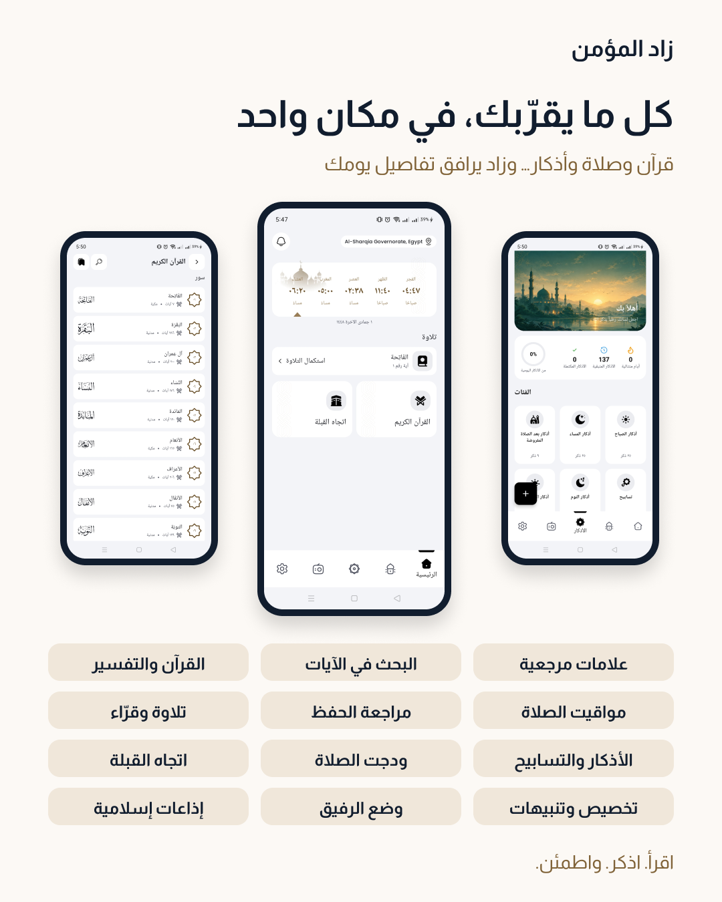
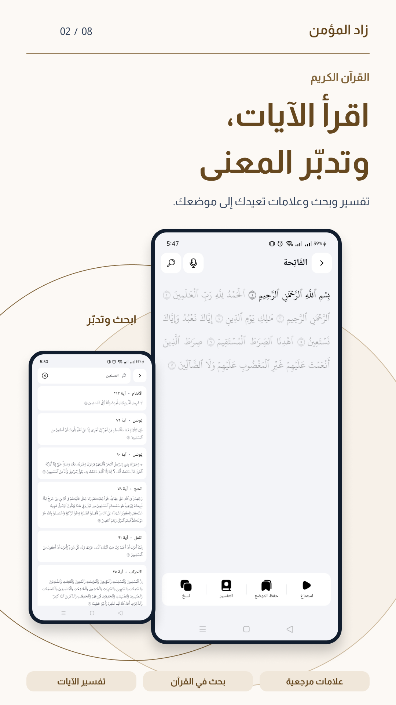
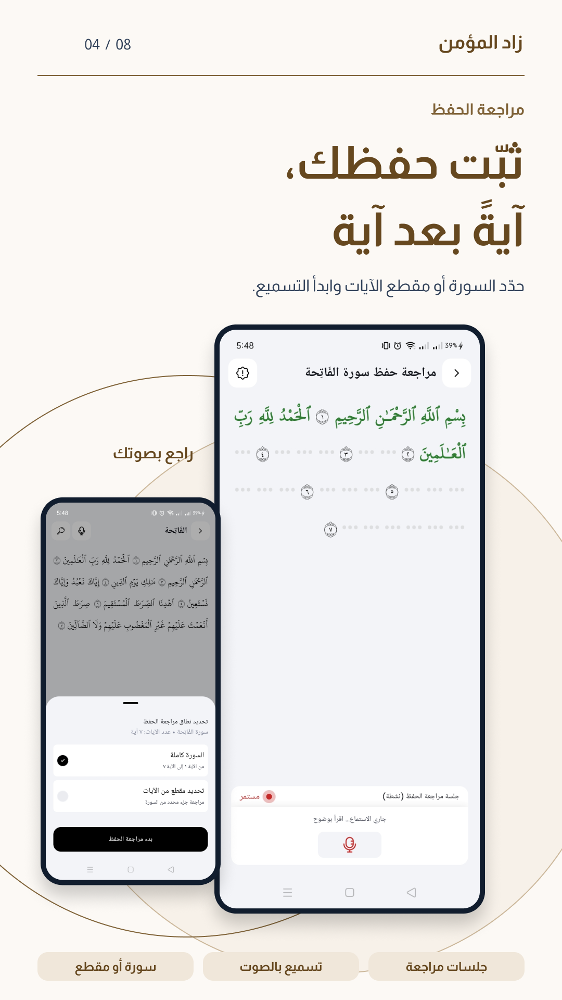
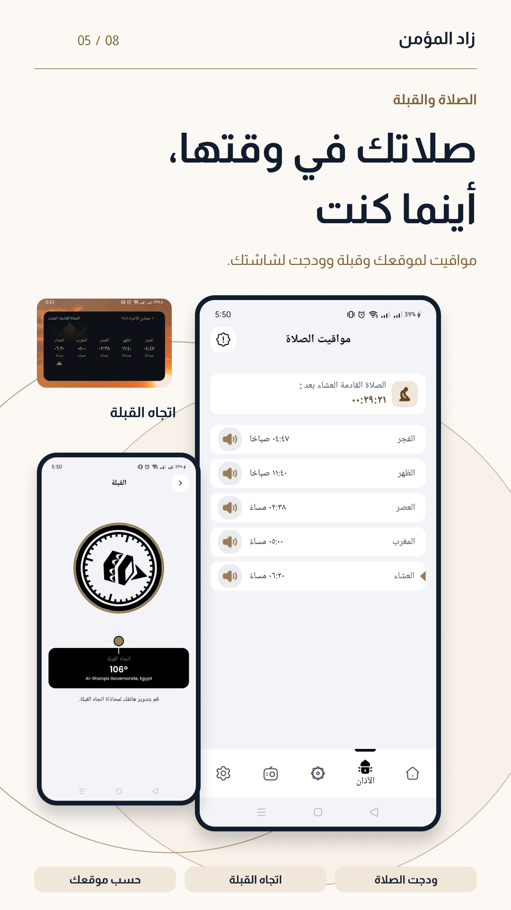
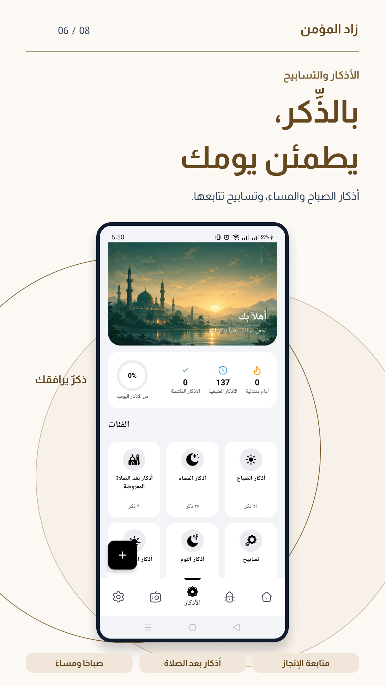
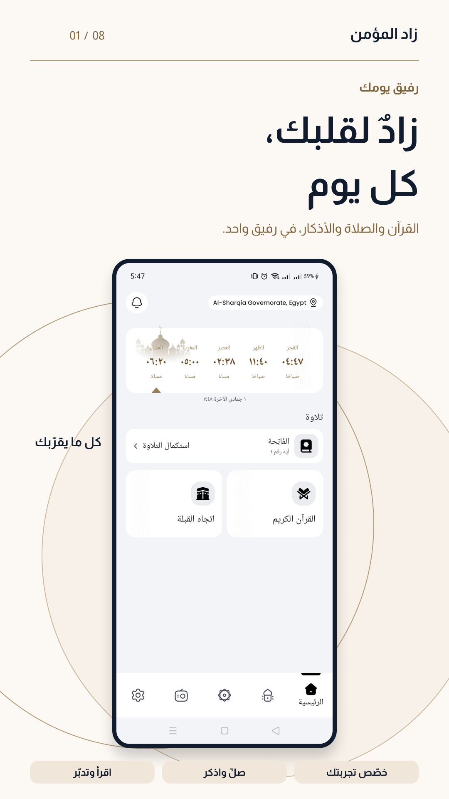
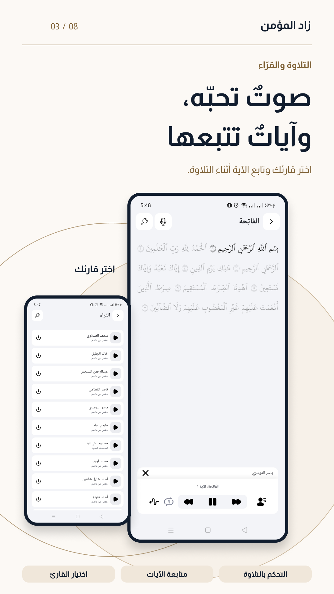
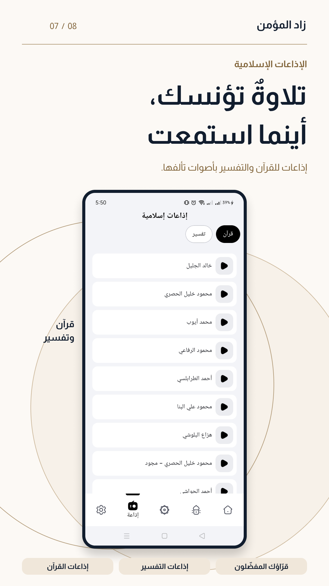
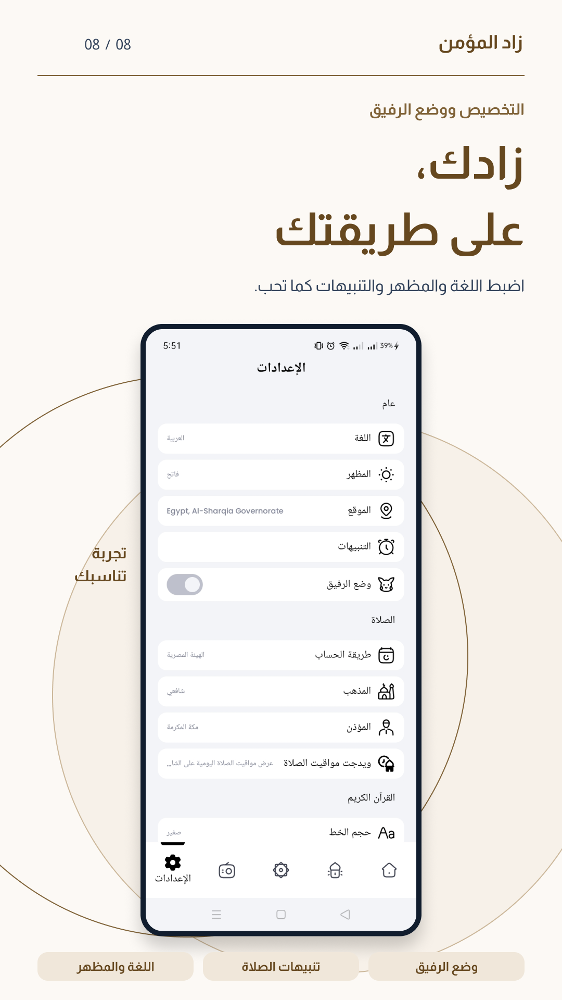

<div align="center">

  <a href="https://github.com/ElsayedMagdy122/Zad-El-Momen">
    
  </a>

  # Zad Al-Mu'min | زاد المؤمن

  An offline-first Android Islamic app built with Jetpack Compose, featuring on-device AI for Quran memorization check, accurate prayer times, and media playback.

  <p>
    <a href="README.ar.md">العربية</a> •
    <a href="#features">Features</a> •
    <a href="#screenshots">Screenshots</a> •
    <a href="#tech-stack">Tech Stack</a> •
    <a href="#getting-started">Getting Started</a> •
    <a href="#contributing">Contributing</a> •
    <a href="#data-sources--credits">Credits</a>
  </p>

  <p>
    
    
    
    
    
    
  </p>

  <p>
    <a href="https://play.google.com/store/apps/details?id=dev.sayed.mehrabalmomen">
      
    </a>
  </p>

  <br/>

  

</div>

## Features

* **Offline AI Recitation Check:** Test Quran memorization with on-device speech recognition via Sherpa-ONNX. Audio is processed strictly in memory on the device.
* **Holy Quran & Tafsir:** Complete Uthmani text with exegesis, word search, and bookmarks.
* **Prayer Times & Athan:** Astronomical calculation engine with multiple methods, schools of thought, and exact alarm notifications.
* **Qiblah Compass:** Real-time Kaaba direction using device geomagnetic sensors with sensor calibration support.
* **Adhkar & Supplications:** Fortress of the Muslim (Hisn al-Muslim) with a built-in counter.
* **Faithful Companion:** Daily religious reminders and sunnah practices.
* **Live Quran Radio:** 24/7 online Islamic radio stations with background playback via Media3 ExoPlayer.
* **Home Widget:** Compact home screen widget showing upcoming prayer times and countdown.

## Screenshots

<div align="center">
  <table>
    <tr>
      <td width="50%"></td>
      <td width="50%"></td>
    </tr>
    <tr>
      <td width="50%"></td>
      <td width="50%"></td>
    </tr>
    <tr>
      <td width="50%"></td>
      <td width="50%"></td>
    </tr>
    <tr>
      <td width="50%"></td>
      <td width="50%"></td>
    </tr>
  </table>
</div>

## Tech Stack

* **UI:** Jetpack Compose, Material 3, Custom Design System, Coil.
* **Architecture:** Clean Architecture with MVI/MVVM (`presentation`, `domain`, `data`).
* **Dependency Injection:** Koin.
* **Local Storage:** Room Database, Jetpack DataStore.
* **Media & Audio:** AndroidX Media3 ExoPlayer.
* **Speech & AI Engine:** Sherpa-ONNX (Embedded on-device ASR).
* **Backend & Monitoring:** Supabase, Firebase (Cloud Messaging, Crashlytics, Performance).
* **Date & Calendar:** Umm al-Qura Calendar library.

## Getting Started

1. Clone the project:
   ```bash
   git clone https://github.com/ElsayedMagdy122/Zad-El-Momen.git
   cd Zad-El-Momen
   ```

2. Add a `local.properties` file in the root directory:
   ```properties
   sdk.dir=/path/to/your/android-sdk
   SUPABASE_URL="your_supabase_url"
   SUPABASE_KEY="your_supabase_key"
   SUPPORT_1="support_1"
   SUPPORT_5="support_5"
   SUPPORT_10="support_10"
   SUPPORT_25="support_25"
   SUPPORT_100="support_100"
   ```

3. Place your `google-services.json` inside the `app/` folder.

4. Build the debug APK:
   ```bash
   ./gradlew assembleDebug
   ```

## Contributing

Contributions are welcome. Follow these steps to submit your changes:

1. Fork the repository and clone your fork locally.
2. Checkout the `develop` branch:
   ```bash
   git checkout develop
   git pull origin develop
   ```
3. Create a new branch following the required naming convention checked by CI:
   `type/branch-name` where `type` is one of: `feature`, `feat`, `fix`, `test`, `refactor`, `chore`, `style`, `screen`, `docs`, `component`, `ci`.
   ```bash
   git checkout -b feature/quran-audio-player
   ```
4. Commit your changes with clear messages, push to your branch, and open a Pull Request targeting `develop`.

For more details, see [CONTRIBUTING.md](CONTRIBUTING.md) and [CODE_OF_CONDUCT.md](CODE_OF_CONDUCT.md).

## Data Sources & Credits

* **Quran Text:** King Fahd Glorious Quran Printing Complex ([مجمع الملك فهد لطباعة المصحف الشريف](https://qurancomplex.gov.sa/)).
* **Quran Tafsir:** Itqan Community ([مجتمع إتقان](https://community.itqan.dev/)).
* **Quran Audio & Recitations:** [MP3Quran.net](https://www.mp3quran.net/).
* **On-Device AI Model:** [QuranLab.ai](https://quranlab.ai/) integrated via [Sherpa-ONNX](https://github.com/k2-fsa/sherpa-onnx).

## License

This project is open-source under the [Apache 2.0 License](LICENSE).
