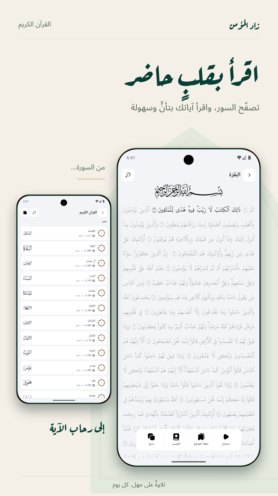
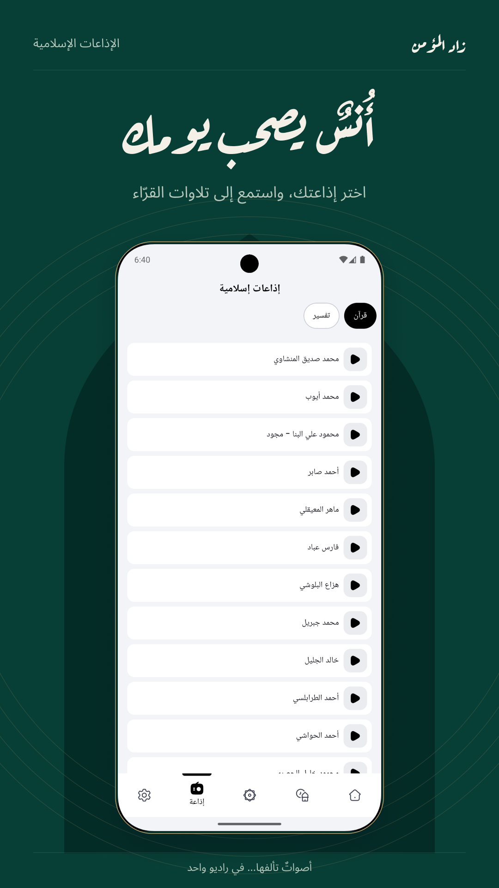
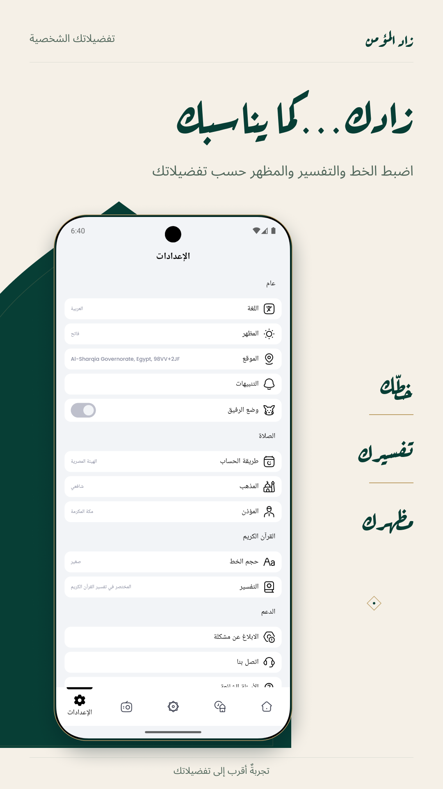
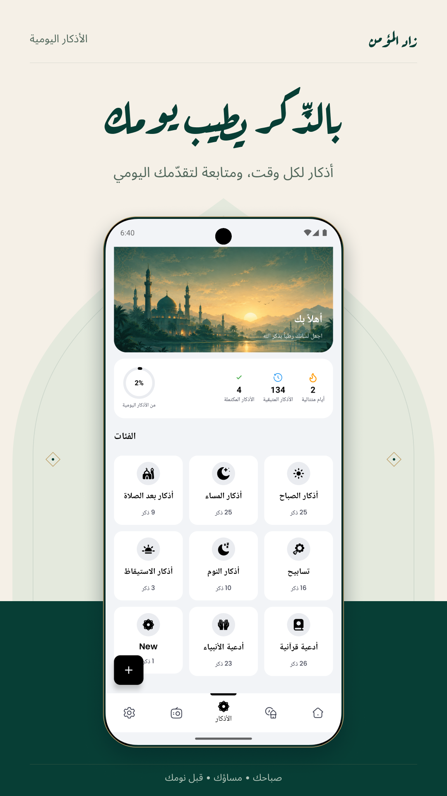

# زاد المؤمن (Zad El Momen)

> تطبيق إسلامي متكامل ومطور بعناية ليكون رفيقك اليومي في العبادة والذكر، مبني باستخدام أحدث تقنيات أندرويد المعاصرة ومعمارية هندسية نظيفة (Clean Architecture).

---

## 🌟 غلاف التطبيق (Cover)

> 

---

## 📖 نظرة عامة (Overview)

تطبيق **زاد المؤمن** هو تطبيق أندرويد احترافي يهدف لتلبية احتياجات المسلم اليومية من مواقيت الصلاة، القرآن الكريم، الأذكار، تحديد القبلة، الاستماع للإذاعات الإسلامية، والتنبيهات المخصصة. تم تصميم التطبيق وتطويره وفقاً لأفضل الممارسات الهندسية (Clean Architecture & MVVM) باستخدام لغة Kotlin ونظام واجهات المستخدم التصريحي Jetpack Compose.

---

## ✨ المميزات الرئيسية (Features)

| الميزة | الوصف التقني والوظيفي |
| :--- | :--- |
| **مواقيت الصلاة والأذان (Prayer Times)** | حساب دقيق لمواقيت الصلاة بناءً على الموقع الجغرافي وطرق الحساب المعتمدة مع إشعارات الأذان التلقائية وجدولة التنبيهات عبر `AlarmManager` و `Foreground Service`. |
| **تحديد اتجاه القبلة (Qiblah)** | بوصلة دقيقة ومتقدمة لحساب اتجاه القبلة استناداً إلى الحساسات والخدمات الجغرافية (`LocationRepository`). |
| **القرآن الكريم (Holy Quran)** | تصفح المصحف الشريف بالرسم العثماني، التفسير الميسر والمختصر، الحفظ، الإشارات المرجعية (`BookmarkDao`)، ومتابعة تقدم القراءة. |
| **التلاوات الصوتية (Audio Recitations)** | الاستماع للقرآن الكريم بصوت نخبة من القراء، مع إمكانية التحميل والاستماع في الخلفية دون إنترنت باستخدام `ExoPlayer` (Media3) و `WorkManager`. |
| **حصن المسلم والأذكار (Azkar & Duas)** | مكتبة شاملة للأذكار والأدعية مقسمة في تصنيفات مع إحصاءات وسجل الاستخدام (`AzkarDao` & Room Database). |
| **الإذاعة الإسلامية (Islamic Radio)** | بث مباشر للإذاعات الإسلامية وقرآن الفجر والمحاضرات عبر مشغل وسائط مدمج وخدمة خلفية (`RadioPlayerService`). |
| **الرفيق والمزاج (Companion & Mood)** | تفاعلات واجهات ذكية ومحتوى متجدد يتناسب مع حالة المستخدم اليومية والتذكيرات الذكية. |
| **الإبلاغ عن المشاكل والدعم (Support & Bug Reports)** | إرسال بلاغات الأخطاء والتبرعات لدعم التطبيق عبر `Supabase` و `Google Play Billing`. |

---

## 🏛️ البنية الهيكلية والتقنية (Architecture & Tech Stack)

يتبع المشروع معمارية **Clean Architecture** المفصولة إلى ثلاث طبقات رئيسية:
1. **Presentation Layer**: واجهات المستخدم بـ Jetpack Compose و Material 3، مع إدارة الحالة عبر ViewModel.
2. **Domain Layer**: نماذج الكيانات (Entities)، حالات الاستخدام (Use Cases)، واجهات المستودعات (Interfaces).
3. **Data Layer**: المستودعات (Repositories)، مصادر البيانات المحلية (Room Database, SharedPreferences)، مصادر البيانات السحابية (`Supabase` و `Firebase`).

### التقنيات والمكتبات المستخدمة:
- **لغة البرمجة**: Kotlin 2.0+
- **واجهات المستخدم**: Jetpack Compose & Material 3
- **حقن التبعيات (DI)**: Koin BOM
- **قاعدة البيانات المحلية**: Room (مع KSP)
- **الشبكات والسحاب**: Supabase (PostgreSQL, RPC, Storage) & Ktor / Retrofit
- **خدمات فايربيز (Firebase)**: Firebase Analytics, Crashlytics, Cloud Messaging (FCM), Firebase Performance
- **الوسائط المتعددة والصوت**: AndroidX Media3 ExoPlayer
- **إدارة المهام في الخلفية**: WorkManager

---

## ⚙️ متطلبات التشغيل والتطوير (Prerequisites)

- **Android Studio**: إصدار Ladybug أو أحدث.
- **JDK**: Java 11 أو أحدث.
- **Android SDK**: Compile SDK 36, Min SDK 26.
- **Gradle**: 8.x+

---

## 📱 واجهات وشاشات التطبيق (App Screenshots & Showcase)

### 1. القرآن الكريم (Holy Quran)
> 
> *تصفح سور القرآن الكريم والتلاوة بتأنٍ وسهولة.*

### 2. التلاوات والقراء (Audio Recitations)
> 
> *اختيار القارئ المفضّل والاستماع للتلاوات.*

### 3. الإذاعات الإسلامية (Islamic Radio)
> 
> *استمع إلى البث المباشر لإذاعات القرآن الكريم.*

### 4. الإعدادات والتفضيلات الشخصية (Settings)
> 
> *تخصيص الخط، التفسير، والمظهر حسب رغبتك.*

### 5. مواقيت الصلاة والأذان (Prayer Times)
> 
> *متابعة أوقات الصلاة والوقت المتبقي للصلاة القادمة.*

### 6. الأذكار اليومية (Daily Azkar)
> 
> *حصن المسلم وأذكار الصباح والمساء ومتابعة التقدم.*

### 7. البحث والعلامات المرجعية (Search & Bookmarks)
> 
> *البحث الفوري في الآيات وحفظ المواضع للعودة إليها.*

### 8. رفيق يومك (Daily Companion)
> 
> *مواقيت صلاتك ووردك القرآني في مكان واحد.*

---

## ⚖️ الترخيص (License)
هذا المشروع مرخص تحت رخصة **GNU General Public License v3.0 (GPLv3)**. تتيح لك الرخصة قراءة الكود، التعلم منه، والاستفادة منه تعليمياً وشخصياً، بينما تمنع قانونياً أي شخص من إعادة نشر التطبيق كمشروع مغلق المصدر أو نسبه لنفسه على المتاجر دون فتح مصدره وحفظ الحقوق. للمزيد من التفاصيل راجع [LICENSE.md](LICENSE.md).

---

## 🔗 روابط سريعة (Quick Links)

- [English Documentation (README_EN.md)](README_EN.md)
- [Setup & Build Guide (SETUP.md)](SETUP.md)
- [Contributing Guidelines (CONTRIBUTING.md)](CONTRIBUTING.md)
- [License (LICENSE.md)](LICENSE.md)
