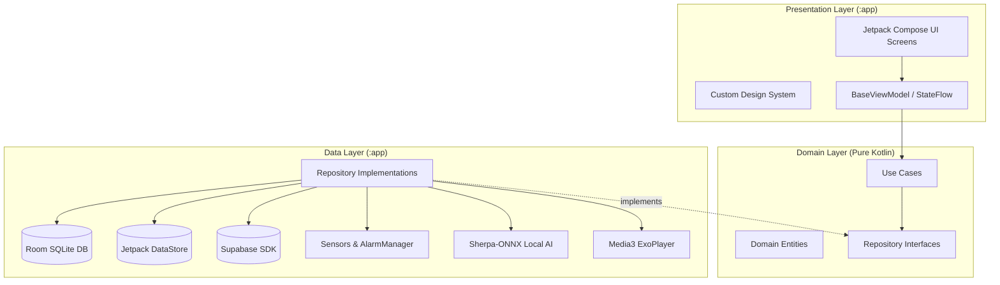

# 🏛️ Architecture & Project Structure

**Zad Al-Mu'min** follows strict **Clean Architecture** and **MVI / MVVM** principles with unidirectional data flow (UDF). The core business logic is completely decoupled from Android framework APIs.

---

## 📐 Layer Breakdown



### 1. `domain` Layer (Pure Kotlin)
- **Zero Android framework dependencies** (`android.*` imports are prohibited).
- **`entity/`**: Core immutable domain models (`Ayah`, `Surah`, `PrayerTime`, `Dhikr`).
- **`repository/`**: Abstract interfaces and contracts.
- **`usecase/`**: Single-responsibility business use cases (`PrayerSchedulingUseCase`, `ObserveCompanionUseCase`).

### 2. `data` Layer
- Implements repository interfaces defined in `domain`.
- **`local/`**: Room DAOs, entity definitions, and DataStore preferences.
- **`remote/`**: Supabase client integrations and network DTOs.
- **`tasmee3/` & `quran/speech/`**: Sherpa-ONNX local speech recognition model bindings.
- **`platform/`**: System interactions (`AndroidAlarmScheduler`, `NotificationScheduler`).
- **`mapper/`**: Bidirectional transformation between DTOs, database entities, and domain models.

### 3. `presentation` & `design_system` Layer
- **Jetpack Compose UI**: Unidirectional data flow where ViewModels expose `StateFlow<UiState>` and handle `UiEvent`.
- **`design_system/`**: Centralized design tokens (colors, typography, custom components: `PrimaryButton`, `AppTextField`, `BottomSheetDs`).
- **`widget/`**: Android Home Screen Widget (`PrayerTimesWidgetProvider`).
- **`service/`**: Foreground audio service (`Media3`) and prayer alarm service.

---

## 📁 Package Structure

```text
dev.sayed.mehrabalmomen/
├── data/
│   ├── di/               # Koin modules (Local, Remote, Repository)
│   ├── azkar/            # Azkar local DAO & repository
│   ├── quran/            # Quran text, audio & speech data sources
│   ├── prayer/           # Prayer times calculation & mappers
│   ├── qiblah/           # Geomagnetic sensor implementation
│   ├── radio/            # Live radio streaming data sources
│   ├── tasmee3/          # Sherpa-ONNX model bindings
│   ├── companion/        # Daily companion repository
│   ├── platform/         # AlarmScheduler & NotificationScheduler
│   └── util/             # AppDatabase, BillingManager
├── domain/
│   ├── di/               # DomainModule (Koin)
│   ├── entity/           # Pure business entities
│   ├── repository/       # Repository interfaces
│   └── usecase/          # Business logic use cases
├── presentation/
│   ├── di/               # PresentationModule (ViewModels)
│   ├── base/             # BaseViewModel, MainActivity
│   ├── navigation/       # Navigation graph & routes
│   ├── screen/           # Feature screens (quran, prayer, azkar...)
│   ├── widget/           # AppWidget provider
│   ├── service/          # Media3 audio & Alarm services
│   └── components/       # Shared UI components
└── design_system/
    ├── theme/            # MehrabTheme
    ├── color/            # Color palettes
    ├── text_style/       # Arabic & Latin typography
    └── component/        # Reusable design tokens
```
